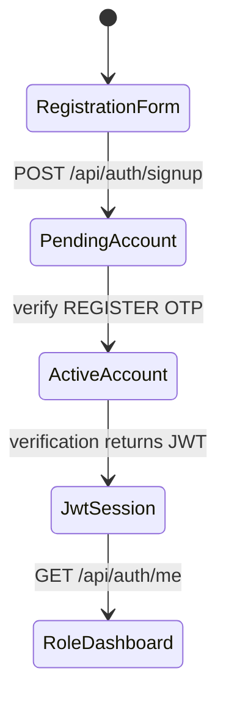
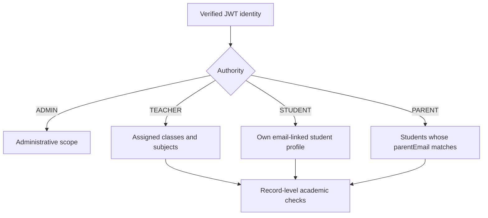
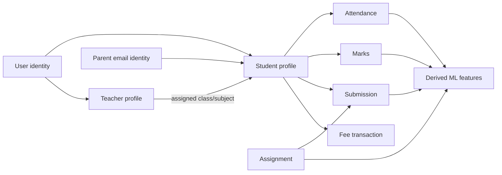

# CampusCore feature implementation guide

This guide describes the behavior that exists in the current repository. It is both a handoff map for contributors and a candid portfolio scope statement: the presence of a page or MongoDB model does not by itself mean an end-to-end feature is finished.

Use the [setup guide](./SETUP_GUIDE.md) to run the stack and the generated Swagger UI at `http://localhost:8080/swagger-ui.html` to inspect the live backend contract.

## Status language

| Status | Meaning |
| --- | --- |
| Integrated | A real frontend workflow calls a protected backend flow and handles loading, empty, and error states |
| API-ready | Secured backend behavior exists, but a complete role-appropriate UI does not |
| Partial | A meaningful slice works, while important lifecycle steps are absent |
| Prototype | The screen contains static/sample data or non-functional controls and must not be presented as live |
| Planned | No reliable implementation is available yet |

## Capability map

| Capability | API | Frontend | Status | Notes |
| --- | --- | --- | --- | --- |
| Registration and login OTP | Yes | Yes | Integrated | Public signup is student/parent only; registration and every password login require email OTP |
| Password reset | Yes | Yes | Integrated | Generic forgot response and hashed, expiring reset tokens |
| Role/route enforcement | Yes | Yes | Integrated | Backend authorities remain the security boundary; frontend guards improve navigation |
| Admin user provisioning | Yes | Yes | Integrated | Creates admin, teacher, student, or parent accounts; teacher/student details are captured in the admin workflow |
| Student profiles | Yes | Yes | Integrated | Admin CRUD plus student self and linked-parent reads |
| Teacher assignments | Yes | Yes | Integrated | Class and subject assignments drive roster and academic authorization |
| Attendance | Yes | Yes | Integrated | Assigned-class roster, teacher marking, student view, parent view, class/date records, QR payload |
| Marks | Yes | Student/parent reads | Partial | Staff create/update endpoints exist; staff marks-entry UI is still missing |
| Assignments | Yes | Teacher create/student submit | Partial | File upload and feedback display work; grading endpoint has no finished staff UI |
| Exams and questions | Yes | Create/publish/list | Partial | No secured attempt, answer persistence, timer, or full result workflow |
| Fees | Yes | Student read | Partial | Real balances/history; admin finance dashboard is static and online payments are not integrated |
| Announcements | Yes | Parent portal read | Partial | Parent portal reads server data; standalone announcement board remains mock and role targeting is incomplete |
| Activities | Yes | Admin management | Integrated | Admin page uses CRUD service |
| Student-risk prediction | Yes | No connected ML UI | API-ready | Protected Spring flow derives real academic inputs and calls an internal synthetic-demo model |
| Secure file upload | Yes | Assignment submission | Integrated | Size/type/signature/path validation and persistent storage |
| Library | CRUD API | Static admin page | Prototype | Do not treat sample books as database records |
| Transport | CRUD/location API | Static admin page | Prototype | No GPS provider or live tracking |
| Timetable | CRUD/publish API | Static admin page | Prototype | No integrated timetable editor |
| Events and report cards | Backend resources | No complete UI | API-ready/partial | Require contract and ownership hardening before production |
| Messages and notifications | Backend resources | No complete UI | API-ready/partial | Currently restricted to administrators by the security map |
| Payroll, reports, finance analytics | No complete workflow | Static screens | Prototype | Values and charts are presentation data |
| AI question generation | Disabled | Honest disabled state | Planned | No provider is configured and no output is simulated |
| Internationalization | English/Tamil assets | Provider and controls | Partial | Translation completeness has not been audited |

## Identity lifecycle

### Public registration



The backend validates a strong password and accepts only `STUDENT` or `PARENT` for public signup. A user cannot self-register as staff by changing the browser request.

### Login

1. `POST /api/auth/login` verifies email/password and account state.
2. The API replaces any previous login challenge and emails a short-lived `LOGIN_2FA` OTP.
3. `POST /api/auth/verify-otp` validates purpose, expiry, BCrypt hash, and attempt count.
4. The successful response contains a JWT and a safe user DTO, never a password or reset token.
5. The frontend stores one token, verifies it through `GET /api/auth/me`, and routes by the returned role.

### Account recovery

`POST /api/auth/forgot-password` always returns a generic response. For an eligible account, the backend emails a link containing a random token while storing only its hash and expiry. `POST /api/auth/reset-password` consumes that token and clears it after use.

### Administrator provisioning

An administrator can use `/admin/users` or `POST /api/admin/users`. Public registration rules do not apply to this protected route. For student and teacher roles, the UI follows account creation with the corresponding profile request. Those two writes are not transactional; if the profile request fails, the UI reports that the account exists but its role profile still needs completion.

## Authorization model



| Resource | Admin | Teacher | Student | Parent |
| --- | --- | --- | --- | --- |
| Student management | Full | Read where permitted | Self | Linked children |
| Attendance and marks | Full | Assigned class/subject | Self read | Linked-child read |
| Assignments | Full | Assigned class/subject manage | Available/self submit | Linked-child read |
| Fees | Full | No access | Self read | Linked-child read |
| Student-risk ML | Any student | Assigned-class students | No access | No access |
| Teacher profile/roster | Full | Own profile/assigned classes | No access | No access |

The teacher attendance UI uses `/api/teacher/classes` and `/api/teacher/classes/{classId}/students`, so it does not bootstrap from an all-student browser list. The older staff-wide `GET /api/students` route still permits teachers and should be narrowed or deprecated before production.

## Academic workflows

### Student and teacher profiles

- `User` stores authentication identity and a strict `UserRole`.
- `Student` links to a user by `userId`/email and to parents through normalized `parentEmail`.
- `TeacherProfile` links a teacher user to `assignedClassIds` and `assignedSubjects`.
- The parent lookup uses the authenticated parent's email; callers cannot select an arbitrary parent identity.
- Core services resolve the authenticated identity before accepting a student ID from a route or request body.

### Attendance

Teachers select one of their assigned classes, load its server roster and existing records for a date, then submit one of `PRESENT`, `ABSENT`, `LATE`, or `EXCUSED` for each student. Future dates are rejected. A unique MongoDB index prevents duplicate student/class/date records; repeat marking updates the existing logical record instead of creating a second one.

Students use `/api/attendance/me`. Parents use linked-student routes after server-side relationship checks. `GET /api/attendance/qr/{classId}/date/{date}` generates a QR representation for authorized class workflows; it is not biometric verification or a signed physical-presence system.

### Marks

The staff API accepts a score and a positive `totalMarks`, rejects a score greater than the total, records the acting teacher/admin, and can associate an optional `examId`. Students and parents retrieve only authorized records. The student and parent pages calculate normalized displays from persisted results.

Missing piece: no polished teacher/admin marks-entry and editing screen is currently wired.

### Assignments and submissions

Teachers/admins create assignments for authorized classes/subjects with a future due date and positive maximum mark. Students see assignments for their own class and can submit text and an optional uploaded file. The backend derives the student identity from the JWT, prevents cross-student submission, and maintains one submission per assignment/student. Late state is computed from the server deadline.

`PATCH /api/assignments/submissions/{id}/grade` validates a non-negative mark against the assignment maximum and accepts optional feedback. Students can see feedback in their assignment view, but staff still need a grading workspace.

### Exams and questions

Teachers/admins can create future-dated `MCQ`, `ESSAY`, or `MIXED` exam definitions, manage questions through the API, and publish drafts. Students can list non-draft exams for their class.

This is not yet a complete online-exam product. There is no attempt entity, candidate answer persistence, robust availability enforcement, timer, submission finalization, essay review queue, or end-to-end results flow. `POST /api/questions/{questionId}/check-answer` is a question-level helper, not a secure exam engine.

### Fees

Administrators manage fee structures and record transactions through protected APIs. Students and linked parents can read their records and computed summaries. The default currency is configured by `FEE_CURRENCY` and is `LKR` in the examples.

There is no configured payment gateway. For `ONLINE` input, the backend records a `PENDING` transaction and does not credit an unverified amount. `CASH`, `CHEQUE`, and `TEST` are explicit administrative recording modes. A real integration requires server-created payment intents, signed webhooks, idempotency, reconciliation, refunds, and receipt generation.

### Announcements and parent portal

The parent portal loads children tied to the authenticated parent, then retrieves attendance, marks, and backend announcements. Announcement create/delete APIs are restricted to admin/teacher and reads require authentication.

The standalone `/announcements` screen still renders mock content, and announcement audience fields are not yet enforced as a complete per-role delivery policy. Do not advertise real-time or targeted notification delivery.

## Student-risk prediction

### Real-data application route

Use:

```text
POST /api/ml/students/{studentId}/predict
Authorization: Bearer <admin-or-teacher-jwt>
```

The Spring controller performs student access checks before loading data. It derives:

- attendance rate from counted attendance records;
- normalized mean marks;
- the difference between up to three recent and three prior marks;
- completion rate across due class assignments; and
- missed overdue assignment count, capped at 50.

It then calls `${ML_SERVICE_URL}/predict` with a 3-second connect timeout and 10-second read timeout. Downstream failures become a sanitized HTTP 503.

The application response shape is:

```json
{
  "student_id": "<mongo-student-id>",
  "derived_inputs": {
    "attendance_percentage": 88.0,
    "average_marks": 74.0,
    "assignment_completion_rate": 90.0,
    "recent_grade_trend": 3.0,
    "missed_assignments": 1
  },
  "prediction": {
    "risk_level": "LOW",
    "probabilities": {
      "LOW": 0.9964837936,
      "MEDIUM": 0.0035161903,
      "HIGH": 0.0000000161
    },
    "confidence": 0.9964837936,
    "feature_contributions": [
      {
        "feature": "missed_assignments",
        "value": 1.0,
        "contribution": 3.1152951988,
        "direction": "supports_prediction"
      },
      {
        "feature": "assignment_completion_rate",
        "value": 90.0,
        "contribution": 1.9201895398,
        "direction": "supports_prediction"
      },
      {
        "feature": "attendance_percentage",
        "value": 88.0,
        "contribution": 1.4516930831,
        "direction": "supports_prediction"
      },
      {
        "feature": "average_marks",
        "value": 74.0,
        "contribution": 1.3584144912,
        "direction": "supports_prediction"
      },
      {
        "feature": "recent_grade_trend",
        "value": 3.0,
        "contribution": 0.4105310957,
        "direction": "supports_prediction"
      }
    ],
    "model_version": "synthetic-v1-<artifact-hash>",
    "disclaimer": "<human-review notice>"
  }
}
```

These values are the reproducible output for the documented seed-42 artifact and inputs. Retraining with another seed, sample count, or library version can change the probabilities, contributions, and model hash.

### Raw aggregate route

`POST /api/ml/predict` is also limited to `ADMIN` and `TEACHER`. It accepts the five validated aggregate inputs directly:

```json
{
  "attendance_percentage": 88,
  "average_marks": 74,
  "assignment_completion_rate": 90,
  "recent_grade_trend": 3,
  "missed_assignments": 1
}
```

Use the student-specific route for normal application behavior because it derives features consistently and enforces access to the underlying record.

### Internal FastAPI contract

| Endpoint | Purpose | Exposure in Compose |
| --- | --- | --- |
| `GET /health` | Model load/readiness state and model version | Internal |
| `GET /metrics` | Training metadata, synthetic notice, holdout metrics, global importance | Internal |
| `POST /predict` | One validated prediction | Internal |
| `POST /predict/batch` | 1–100 validated predictions | Internal |
| `GET /docs` | FastAPI Swagger UI | Internal |

The persisted pipeline is `StandardScaler` plus multinomial `LogisticRegression`. Training is deterministic for a fixed seed, stores feature/schema/library metadata, and refuses incompatible artifacts. Per-prediction contributions describe the selected class's linear score; they are not causal explanations.

The standard synthetic training command is:

```bash
cd ml-service
python -m app.training --samples 3000 --seed 42 \
  --output artifacts/student_risk_pipeline.joblib \
  --metrics-output artifacts/training_metrics.json
```

The resulting synthetic holdout has approximately `0.8283` accuracy and `0.8288` macro F1 for model `synthetic-v1-8015c416e222`. These are reproducibility checks for generated data, not evidence of real-student performance.

### Responsible-use boundary

- Never use a risk label to automatically punish, exclude, stream, rank, or discipline a student.
- Treat missing records as a data-quality issue; for example, no attendance currently derives to `0%`, while no due assignments derives to `100%` completion.
- Require an educator to inspect source records, contextual factors, and possible entry errors.
- Do not add protected attributes or raw identifiers to the model input.
- Before real use, establish consent/lawful purpose, retention rules, representative evaluation, subgroup fairness, calibration, drift monitoring, appeal/correction, and audited access.
- If those controls cannot be met, leave the model disabled.

## Backend API catalog

All paths below are relative to the backend origin. The frontend base URL already includes `/api`.

### Authentication and profiles

| Method | Path | Purpose |
| --- | --- | --- |
| `POST` | `/api/auth/signup` or `/api/auth/register` | Register student/parent and send registration OTP |
| `POST` | `/api/auth/login` | Verify password and send login OTP |
| `POST` | `/api/auth/verify-otp` | Verify `REGISTER` or `LOGIN_2FA` challenge and issue JWT |
| `POST` | `/api/auth/resend-otp` | Replace an eligible OTP challenge |
| `POST` | `/api/auth/forgot-password` | Request non-enumerating reset flow |
| `POST` | `/api/auth/reset-password` | Consume reset token and change password |
| `GET` | `/api/auth/me` | Return verified current identity |
| `POST` | `/api/admin/users` | Admin-only user provisioning |
| `PUT` | `/api/admin/teachers/profile` | Admin-only teacher class/subject profile upsert |
| `GET` | `/api/teacher/profile` | Current teacher profile |
| `GET` | `/api/teacher/classes` | Current teacher's assigned classes |
| `GET` | `/api/teacher/classes/{classId}/students` | Authorized assigned-class roster |
| `GET` | `/api/parents/children` | Current parent's linked students |

### Students and academic records

| Method | Path | Purpose |
| --- | --- | --- |
| `POST` / `GET` | `/api/students` | Admin create / staff list |
| `GET` | `/api/students/page` | Staff paginated list |
| `GET` | `/api/students/me` | Current student profile |
| `GET` | `/api/students/parent` | Current parent's students |
| `GET` | `/api/students/class/{classId}` | Authorized class roster |
| `GET` / `PUT` / `DELETE` | `/api/students/{id}` | Contextual read / admin update/delete |
| `POST` | `/api/attendance` or `/api/attendance/mark` | Mark or replace attendance for student/class/date |
| `GET` | `/api/attendance/me` | Current student's attendance |
| `GET` | `/api/attendance/student/{studentId}` | Authorized student attendance |
| `GET` | `/api/attendance/class/{classId}/date/{date}` | Authorized class/date attendance |
| `GET` | `/api/attendance/qr/{classId}/date/{date}` | Authorized QR payload |
| `POST` / `GET` | `/api/marks` | Staff create / staff list |
| `PUT` | `/api/marks/{id}` | Staff update |
| `GET` | `/api/marks/me` | Current student's marks |
| `GET` | `/api/marks/student/{studentId}` | Authorized student marks |

### Assignments and exams

| Method | Path | Purpose |
| --- | --- | --- |
| `POST` / `GET` | `/api/assignments` | Staff create / role-filtered list |
| `GET` | `/api/assignments/available` | Current student's available assignments |
| `GET` | `/api/assignments/student/{studentId}` | Authorized student assignments |
| `GET` | `/api/assignments/class/{classId}` | Authorized class assignments |
| `GET` / `PUT` / `DELETE` | `/api/assignments/{id}` | Contextual read / staff manage |
| `POST` | `/api/assignments/submissions` | Current student submits |
| `GET` | `/api/assignments/submissions/mine` | Current student's submissions |
| `GET` | `/api/assignments/submissions/student/{studentId}` | Authorized student submissions |
| `GET` | `/api/assignments/submissions/assignment/{assignmentId}` | Authorized assignment submissions |
| `PATCH` | `/api/assignments/submissions/{id}/grade` | Staff grade and comment |
| `POST` / `GET` / `PUT` / `DELETE` | `/api/exams/**` | Staff exam lifecycle and authenticated reads |
| `POST` / `GET` / `PUT` / `DELETE` | `/api/questions/**` | Staff question lifecycle |
| `POST` | `/api/questions/{questionId}/check-answer` | Authenticated answer check helper |

### Fees, content, files, and ML

| Method | Path | Purpose |
| --- | --- | --- |
| CRUD | `/api/fee-structure/**` | Admin writes, student/parent reads |
| `POST` / `GET` | `/api/fee-transactions` | Admin record/list transactions |
| `GET` | `/api/fee-transactions/me` | Current student's transactions |
| `GET` | `/api/fee-transactions/student/{studentId}` | Authorized student transactions |
| `GET` | `/api/fee-transactions/summary` | Current student's summary |
| `GET` | `/api/fee-transactions/student/{studentId}/summary` | Authorized student summary |
| `POST` / `GET` / `DELETE` | `/api/announcements/**` | Staff create/delete, authenticated reads |
| CRUD | `/api/activities/**` | Staff activity management |
| `POST` | `/api/upload` | Admin/teacher/student single upload |
| `POST` | `/api/upload/multiple` | Admin/teacher multiple upload |
| `DELETE` | `/api/upload/{fileName}` | Admin delete |
| `POST` | `/api/ml/students/{studentId}/predict` | Authorized real-data risk prediction |
| `POST` | `/api/ml/predict` | Authorized aggregate-input prediction |

Swagger also lists library, book-issue, timetable, transport, event, report-card, message, and notification controllers. Treat those as backend extension surfaces, not as proof that the current frontend completes their workflows.

## Example requests

Use a token returned by the OTP verification endpoint.

### Mark attendance

```bash
curl --request POST http://localhost:8080/api/attendance \
  --header "Authorization: Bearer <jwt>" \
  --header "Content-Type: application/json" \
  --data '{
    "studentId": "<student-id>",
    "classId": "GRADE-10-A",
    "attendanceDate": "2026-08-21",
    "status": "PRESENT",
    "remark": "Morning register"
  }'
```

### Create marks

```bash
curl --request POST http://localhost:8080/api/marks \
  --header "Authorization: Bearer <jwt>" \
  --header "Content-Type: application/json" \
  --data '{
    "studentId": "<student-id>",
    "subject": "Mathematics",
    "marks": 74,
    "totalMarks": 100,
    "examId": null
  }'
```

### Predict from stored academic records

```bash
curl --request POST \
  http://localhost:8080/api/ml/students/<student-id>/predict \
  --header "Authorization: Bearer <admin-or-teacher-jwt>"
```

Dates shown in examples are illustrative. Assignment/exam creation requires future timestamps relative to the running server.

## Data ownership and invariants



Important persistence rules include:

- User email, student email, teacher profile identity fields, transaction ID, attendance student/class/date, and assignment/student submission pairs have unique indexes where modeled.
- Mongo references are strings and are validated by application services; there are no relational foreign-key cascades.
- Email and role values are normalized before sensitive comparisons.
- Server code—not browser input—selects the current student or parent identity for self-service paths.
- File metadata is stored separately from the bytes, which live under the configured upload root.
- OTP records are ephemeral and removed by verification/replacement logic plus TTL expiration.

## Demo walkthrough

1. Follow the [Docker setup](./SETUP_GUIDE.md#option-a-docker-compose) and opt into demo data.
2. Sign in as `admin@campuscore.local`; obtain the OTP from MailHog.
3. Open the real user-provisioning and student-management pages, or use Swagger/curl to create academic records.
4. Sign in as `teacher@campuscore.local`, select `GRADE-10-A`, and record attendance/create an assignment.
5. Sign in as `student@campuscore.local` to view records and submit work.
6. Sign in as `parent@campuscore.local` to verify linked-child visibility.
7. Add marks and due assignment history, then call the student-specific ML endpoint as admin or teacher.
8. Point out the returned derived inputs, probabilities, contribution directions, model version, and ethics disclaimer.

Because the seed is profile-only, empty academic screens on first launch are the expected, honest state.

## Acceptance and test strategy

The repository currently exercises:

- Frontend role-return routing and open-redirect rejection with Vitest, plus lint, TypeScript, and production build checks.
- Backend application-context startup with Maven/Spring tests and packaging.
- ML synthetic generation, deterministic training, artifact loading, invalid-input rejection, probability/contribution responses, batch limits, metrics, health, and unavailable-model behavior with pytest.
- Compose parsing and all application image builds in CI.

Highest-value additions are:

1. Spring integration tests for every role/method combination and parent/teacher record boundary.
2. Mongo-backed tests for uniqueness, pagination, deadline, grading, and fee invariants.
3. Frontend component tests for loading/error/empty/data states and keyboard/accessibility behavior.
4. Browser journeys for signup OTP, login OTP, admin provisioning, attendance, assignment submission, parent isolation, and expired JWT handling.
5. Contract tests between Spring's ML DTO and FastAPI OpenAPI schema.
6. Security tests for upload polyglots, brute-force limits, CORS, token tampering, IDOR, and sanitized downstream failures.

Commands are maintained in the [setup guide](./SETUP_GUIDE.md#tests-and-verification) and automated in [CI](./.github/workflows/ci.yml).

## Known gaps and implementation order

### Must address before production

- Replace localStorage JWT handling with an evaluated cookie/session design and add the corresponding CSRF defense.
- Add distributed throttling and security/audit event persistence.
- Narrow or retire the staff-wide student listing and audit ownership rules in legacy CRUD controllers.
- Define and enforce announcement audiences rather than returning all announcements to every authenticated reader.
- Add malware scanning and object/durable storage for uploads.
- Expand authorization, integration, and end-to-end test coverage.
- Disable synthetic risk scoring unless a formal governance and validation process approves its use.

### Product completion

- Implement staff marks entry and assignment grading screens.
- Build the complete exam-attempt lifecycle.
- Replace static dashboard, fee analytics, library, transport, timetable, payroll, report, and communication views with real APIs—or remove them from navigation.
- Add verified payment-provider integration and accounting reconciliation.
- Complete translation coverage and accessibility review.
- Connect a carefully reviewed teacher-facing ML experience to the real-data Spring route; remove misleading legacy AI copy.

### Platform maturity

- Add migrations/versioned data repair for Mongo schema changes.
- Add observability, alerting, backups, disaster-recovery testing, dependency scanning, and signed image delivery.
- Add multi-school tenancy only after every query and index has an explicit tenant boundary.

## Contributor workflow

When extending a feature:

1. Define the role and record-ownership rule before the endpoint.
2. Use validated request DTOs; never bind security-sensitive models directly from untrusted JSON.
3. Put business invariants and access checks in services so alternate controllers cannot bypass them.
4. Return safe response DTOs and the shared sanitized error shape.
5. Add a typed frontend service and explicit loading, empty, error, and success states.
6. Add tests at the lowest useful layer plus an integration test for the authorization boundary.
7. Update Swagger-generated annotations/configuration where needed and revise this status map.
8. Add environment variables only to the appropriate `.env.example`; never commit credentials or generated model artifacts.

CampusCore is strongest as a portfolio project when every claim can be reproduced from code, tests, or a running endpoint. Keep prototype visuals clearly labeled until the corresponding persisted workflow exists.
