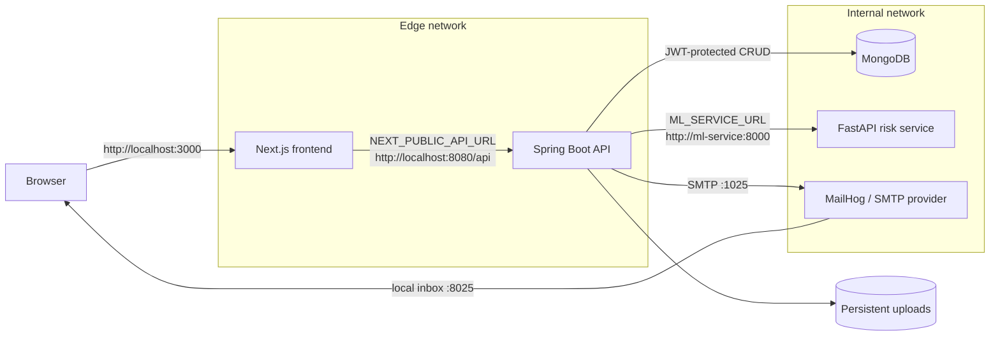
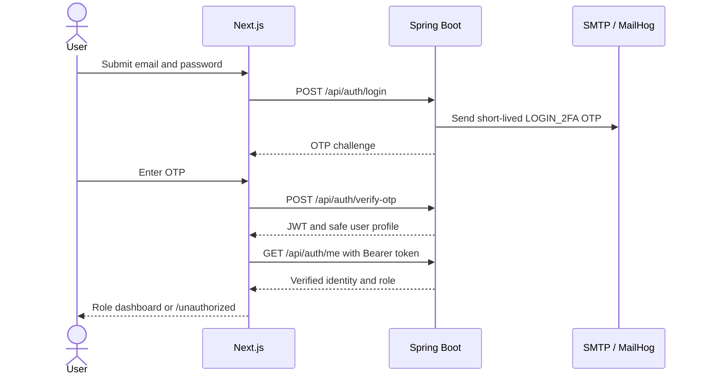
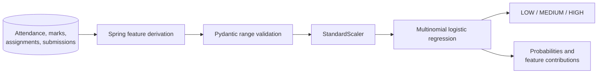
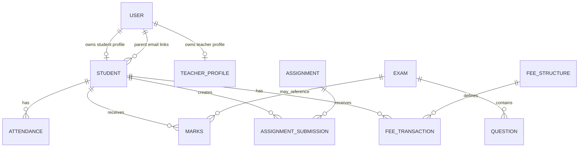

# CampusCore

CampusCore is a portfolio-grade school operations platform built around four authenticated roles: administrators, teachers, students, and parents. It combines a Next.js interface, a Spring Boot REST API, MongoDB, email OTP verification, and an internal FastAPI/scikit-learn service that demonstrates explainable student-support risk scoring.

The repository deliberately distinguishes working, API-backed flows from presentation-only screens. The ML model is trained on synthetic data and is decision support—not an automated decision-maker.

## What is working today

| Area | Current status |
| --- | --- |
| Authentication | Email/password plus OTP for registration and login, password reset, JWT session verification, rate limiting, and role-aware route guards |
| Identity and profiles | Admin user provisioning, student CRUD, parent-to-student linking, teacher class/subject assignments |
| Attendance | Teacher entry, class/date retrieval, student self-view, parent view, and QR payload generation |
| Marks | Protected create/update/read APIs plus student and parent views; no dedicated staff marks-entry screen yet |
| Assignments | Teacher creation, student text/file submission, deadline handling, and a protected grading API; grading UI remains to be built |
| Exams | Teacher create/publish and student published-exam listing; taking an exam, persisting answers, and end-to-end grading are not implemented |
| Fees | Fee structures and transactions in the API, real student balance/history view, configurable `LKR` default; no payment-gateway settlement |
| Parent portal | Reads only linked children and shows their attendance, marks, and server announcements |
| Student-risk ML | Reproducible synthetic training, persisted model, validation, probabilities, feature contributions, metrics, health checks, and protected Spring integration |
| Extended ERP modules | Several backend CRUD resources exist, but library, transport, timetable, payroll, reports, communication, and some dashboard screens remain mock or partial |

See the [feature implementation guide](./FEATURE_IMPLEMENTATION_GUIDE.md) for an endpoint-by-endpoint status map and the [setup guide](./SETUP_GUIDE.md) for detailed configuration.

## Role experiences

| Role | Implemented workflows |
| --- | --- |
| Administrator | Provision all user roles, create teacher/student profiles, manage students and activities, access protected management APIs, and request ML predictions |
| Teacher | Work within assigned classes/subjects, mark attendance, create assignments, create/publish exams, use marks/grading APIs, and request risk predictions for authorized students |
| Student | View their own attendance and marks, browse and submit assignments, list published exams, and view fee balances/history |
| Parent | Select a linked child and view that child's attendance, marks, and announcements |

Public registration intentionally allows only `STUDENT` and `PARENT`. `TEACHER` and `ADMIN` accounts must be provisioned by an authenticated administrator.

## Technology

| Layer | Main technology |
| --- | --- |
| Web | Next.js 15, React 19, TypeScript, Tailwind CSS, Axios, Recharts |
| API | Java 17, Spring Boot 3.5, Spring Security, Spring Data MongoDB, Bean Validation |
| Auth and messaging | JWT, BCrypt, hashed OTP/reset records, Spring Mail, MailHog for local email capture |
| ML | Python 3.12, FastAPI, Pydantic, scikit-learn 1.6, joblib |
| Operations | Docker Compose, health checks, persistent volumes, GitHub Actions |

## Architecture



In Docker, only the frontend, backend, local MongoDB port, and MailHog web UI are published. The ML API and MailHog SMTP listener remain internal. Browser JavaScript must use a browser-reachable URL ending in `/api`; Docker service names such as `backend` are not valid browser URLs.

## Authentication and authorization



Security controls include:

- Stateless Bearer JWT authentication with an HS256 secret of at least 32 bytes.
- BCrypt password hashing with work factor 12.
- Hashed OTP values, expiry, bounded attempts, and a MongoDB TTL index.
- Hashed, short-lived password-reset tokens and non-enumerating forgot-password responses.
- Server-side role checks plus record-level student/parent/teacher access checks.
- A CORS allowlist, sanitized error responses, and authentication endpoint rate limits.
- Upload extension, MIME type, file-signature, size, normalized-path, and randomized-name checks.

The frontend currently stores its JWT in one `localStorage` key. That is practical for this portfolio build but remains sensitive to XSS; a hardened production deployment should migrate to secure, `HttpOnly`, same-site cookies and add a suitable CSRF strategy.

## Student-risk ML pipeline

The production-facing application flow is the protected endpoint:

```text
POST /api/ml/students/{studentId}/predict
```

It is limited to `ADMIN` and `TEACHER`. The backend first verifies access to the requested student, derives aggregate inputs from CampusCore records, and calls FastAPI over the internal network.



The five aggregate inputs are:

| Feature | Range | Backend derivation |
| --- | ---: | --- |
| `attendance_percentage` | 0–100 | `PRESENT` and `LATE` records divided by non-pending attendance records |
| `average_marks` | 0–100 | Mean of marks normalized by each assessment's total |
| `assignment_completion_rate` | 0–100 | Submitted due assignments divided by all due class assignments |
| `recent_grade_trend` | -100–100 | Recent three normalized marks minus up to three preceding marks |
| `missed_assignments` | 0–50 | Overdue class assignments without a submission, capped at 50 |

The response wraps `student_id`, `derived_inputs`, and a prediction containing `risk_level`, class `probabilities`, `confidence`, per-feature contributions, `model_version`, and a disclaimer. The raw `POST /api/ml/predict` endpoint accepts already aggregated inputs and is protected by the same roles.

### Reproducible demo model

The checked training recipe uses 3,000 deterministic synthetic samples and seed `42`. Its generated artifact reports model version `synthetic-v1-8015c416e222` and the following synthetic holdout results:

| Metric | Value |
| --- | ---: |
| Accuracy | 0.8283 |
| Macro precision | 0.8275 |
| Macro recall | 0.8305 |
| Macro F1 | 0.8288 |
| Holdout samples | 600 |

These measurements only describe the synthetic generator's holdout set. They do not establish accuracy, fairness, calibration, or fitness for decisions about real students. See [ML ethics](#ml-ethics-and-responsible-use).

## Data model



MongoDB relationships are application-enforced identifiers rather than relational foreign keys. Additional collections support announcements, activities, events, timetables, library records, transport routes, messages, notifications, report cards, and expiring OTP records.

## Quick start with Docker

Prerequisites: Docker Engine/Desktop with Compose v2.

```bash
cp .env.example .env
# Edit .env: replace MONGO_ROOT_PASSWORD and JWT_SECRET.
docker compose --env-file .env up --build -d
docker compose --env-file .env ps
```

On PowerShell, use `Copy-Item .env.example .env` for the first command. Keep `NEXT_PUBLIC_API_URL=http://localhost:8080/api`; it is embedded into browser code during the frontend image build.

| Service | Local URL |
| --- | --- |
| CampusCore web app | <http://localhost:3000> |
| Spring health | <http://localhost:8080/actuator/health> |
| Swagger UI | <http://localhost:8080/swagger-ui.html> |
| OpenAPI JSON | <http://localhost:8080/api-docs> |
| MailHog inbox | <http://localhost:8025> |
| MongoDB | `mongodb://localhost:27017` with credentials from `.env` |

FastAPI is intentionally not published by Compose. For standalone ML development, its Swagger UI is available at `http://localhost:8000/docs`.

### Optional demo accounts

Set these values before the first backend start:

```env
APP_SEED_DEMO_DATA=true
DEMO_PASSWORD=choose-a-development-only-password
```

The copied template contains the convenience value `DemoOnly!234`; replace it before enabling the seed anywhere that is not a disposable local demo.

The idempotent seed creates active, synthetic profile records only:

| Role | Email | Seeded relationship |
| --- | --- | --- |
| Admin | `admin@campuscore.local` | Administrator account |
| Teacher | `teacher@campuscore.local` | `GRADE-10-A`, Mathematics |
| Student | `student@campuscore.local` | `GRADE-10-A` |
| Parent | `parent@campuscore.local` | Linked to the demo student |

Use the configured `DEMO_PASSWORD` on the login page, then open MailHog and copy the login OTP from the captured email. The seed does not create attendance, marks, assignments, fees, or other academic history; create those through the UI, Swagger, or API. Existing accounts are not overwritten. Disable the seed and change all demo credentials outside local development.

For native setup, all environment variables, test commands, and troubleshooting, read the [setup guide](./SETUP_GUIDE.md).

## API entry points

All application endpoints use the `/api` prefix. Swagger is the authoritative live contract.

| Area | Representative endpoints |
| --- | --- |
| Auth | `POST /api/auth/login`, `/verify-otp`, `/signup`, `/forgot-password`, `/reset-password`; `GET /api/auth/me` |
| Admin and profiles | `POST /api/admin/users`, `PUT /api/admin/teachers/profile`, `/api/students/**`, `GET /api/parents/children` |
| Teaching | `/api/attendance/**`, `/api/marks/**`, `/api/assignments/**`, `/api/exams/**`, `/api/questions/**` |
| Finance | `/api/fee-structure/**`, `/api/fee-transactions/**` |
| ML | `POST /api/ml/students/{studentId}/predict`, `POST /api/ml/predict` |
| Operations | `GET /actuator/health`, `GET /actuator/info` |

Except for authentication, health/info, and OpenAPI resources, endpoints require a valid JWT. Authorization varies by method and resource ownership; a successful login does not imply access to every route.

## Quality gates

```bash
# Frontend
cd frontend
npm ci
npm run lint
npm run typecheck
npm test
npm run build

# Backend (bash)
cd ../backend
./mvnw test
./mvnw -DskipTests clean package

# ML service
cd ../ml-service
python -m pip install -r requirements-dev.txt
pytest
python -m app.training --samples 3000 --seed 42
python -m app.predict_cli --attendance 88 --marks 74 --completion 90 --trend 3 --missed 1

# Compose validation
cd ..
docker compose --env-file .env.example config --quiet
docker compose --env-file .env.example build
```

On Windows, run `backend\mvnw.cmd test`. The current frontend tests focus on safe role routing, the backend test suite includes application-context coverage, and the ML suite covers training, persistence, validation, health, prediction, batch limits, metrics, and failure behavior. Broader backend integration and browser end-to-end coverage remain future work.

The [GitHub Actions workflow](./.github/workflows/ci.yml) runs these frontend, backend, ML, and container checks on pushes to `main` and on pull requests.

## Deployment notes

The Dockerfiles use multi-stage builds and non-root runtime users. Compose adds health checks, read-only application filesystems, `no-new-privileges`, an internal service network, and persistent volumes for MongoDB and uploads.

For a production deployment:

- Terminate TLS at a reverse proxy or platform ingress and publish only the web/API entry points.
- Store `JWT_SECRET`, database credentials, and SMTP credentials in a secret manager; never deploy the example values.
- Set exact HTTPS values for `NEXT_PUBLIC_API_URL`, `FRONTEND_URL`, and `CORS_ALLOWED_ORIGINS`. Rebuild the frontend after changing its public API URL.
- Use a managed MongoDB deployment with authentication, backups, monitoring, and network restrictions.
- Replace MailHog with a real SMTP provider and set `MAIL_FROM` to a verified sender.
- Keep the ML service private and reachable only from the backend.
- Put uploads on durable storage or migrate them to object storage; the local filesystem implementation needs a persistent volume.
- Disable `APP_SEED_DEMO_DATA`, rotate the demo password, and add distributed rate limiting if the API runs on multiple instances.

## Screenshots

No screenshots are committed yet. A portfolio release should add sanitized captures under `docs/screenshots/` using this shot list:

| Planned asset | View to capture |
| --- | --- |
| `login-otp.png` | Login challenge alongside the MailHog OTP email |
| `admin-students.png` | Real student management data and the user-provisioning flow |
| `teacher-attendance.png` | Assigned-class roster and attendance entry |
| `student-assignments.png` | Assignment cards and submission dialog |
| `parent-portal.png` | Linked-child attendance/marks tabs |
| `swagger-ml.png` | Protected real-data ML endpoint and example response |

Do not capture real student data, tokens, passwords, OTPs, or email-provider credentials.

## Known limitations

- Several visually rich admin dashboards use hard-coded sample statistics. Library, transport, timetable, payroll, finance analytics, reports, communication, and the standalone announcements page are not reliable demonstrations of persisted end-to-end data.
- The legacy `/admin/ai` and `/admin/ai/predictor` screens contain presentation-only claims and are not connected to the FastAPI model. Use the protected Spring ML endpoints as the source of truth.
- Exam creation and publication work, but exam attempts, answer persistence, timer enforcement, and complete grading do not.
- Assignment grading and staff marks entry have backend APIs but no finished staff UI.
- There is no Razorpay/PayPal integration. An `ONLINE` fee record remains pending; CampusCore never simulates successful settlement.
- The in-memory auth rate limiter is per backend instance and resets on restart.
- The demo ML model has never been validated on real student data. Sparse or missing academic records can produce unhelpful derived values.
- Automated testing is strongest in the ML service; backend integration, authorization regression, accessibility, and browser end-to-end suites need expansion.
- Internationalization assets exist, but complete translation coverage has not been audited.

## ML ethics and responsible use

CampusCore's risk output must be treated as a prompt for supportive human review. It must not automatically punish, rank, exclude, discipline, or label a student. Before any real deployment, a school would need lawful purpose and consent analysis, data minimization, subgroup fairness and calibration evaluation, drift monitoring, documented appeal and correction paths, access/audit controls, and recurring educator review.

Feature contributions indicate how this linear model's inputs influenced one predicted class; they are not causal explanations. Missing attendance or marks may reflect data-entry gaps rather than student behavior. Human reviewers must examine the underlying records and context before acting.

## Roadmap

- Replace static dashboards with aggregated, server-backed metrics.
- Build teacher marks-entry and assignment-grading workflows.
- Complete secure exam attempts, answer persistence, grading, and result publication.
- Add a real payment provider with webhook verification, idempotency, reconciliation, and receipts.
- Wire or retire prototype ERP screens; enforce ownership on every legacy resource.
- Add HttpOnly cookie sessions, distributed throttling, security event auditing, and refresh-token rotation.
- Train and validate an appropriately governed model on representative, consented data—or keep ML disabled.
- Add backend integration/security tests, frontend component/accessibility tests, and Playwright end-to-end journeys.
- Add observability, backups, migration strategy, and object storage for uploads.

## Portfolio and internship highlights

- Designed a three-service architecture with explicit trust boundaries between browser, API, database, email, and ML components.
- Implemented a two-step authentication lifecycle and layered role plus record-level authorization.
- Integrated academic workflows across React, Spring Boot, and MongoDB while preserving honest loading, empty, and error states.
- Built a reproducible explainable-ML pipeline with strict validation, persisted artifacts, metrics, health behavior, and ethical limitations.
- Added production-oriented containers, health-gated orchestration, environment templates, and multi-stack CI.
- Audited mock UI against real API behavior and documented the gaps instead of overstating product readiness.

## Repository map

```text
School-Management-System/
├── frontend/                 Next.js application
├── backend/                  Spring Boot API
├── ml-service/               FastAPI/scikit-learn service
├── .github/workflows/ci.yml  CI quality gates
├── docker-compose.yml        Local full-stack orchestration
├── SETUP_GUIDE.md            Environment and runbook
└── FEATURE_IMPLEMENTATION_GUIDE.md
```

Start with the [setup guide](./SETUP_GUIDE.md), then use Swagger to explore the live backend contract.
