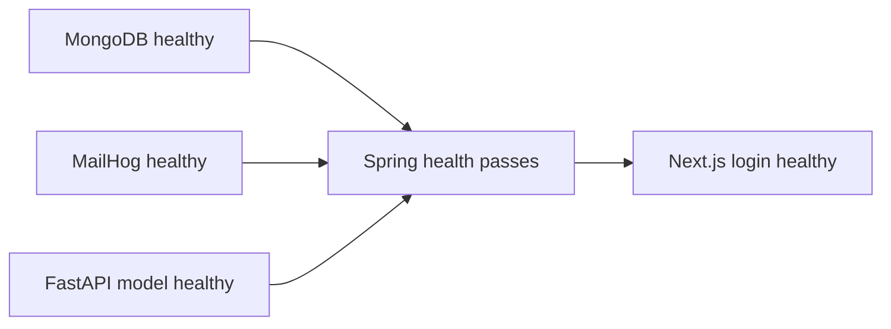

# CampusCore setup guide

This runbook covers both the Docker Compose stack and independent local development. Docker is the shortest path because it wires MongoDB, MailHog, the ML service, Spring Boot, and Next.js with health-gated startup.

## Prerequisites

Choose one setup path:

| Path | Requirements |
| --- | --- |
| Full stack with Docker | Docker Engine or Docker Desktop with Compose v2 |
| Native development | Node.js 20, npm, Java 17, Python 3.12, MongoDB 7-compatible server, and an SMTP server such as MailHog |

The backend includes Maven Wrapper scripts, so a global Maven installation is optional. Git and at least 2 GB of free memory are recommended for either path.

## Option A: Docker Compose

### 1. Create local configuration

From the repository root:

```bash
cp .env.example .env
```

PowerShell equivalent:

```powershell
Copy-Item .env.example .env
```

Edit `.env` and replace at least:

```env
MONGO_ROOT_PASSWORD=use-a-strong-unique-password
JWT_SECRET=use-at-least-32-random-characters
```

Generate a secret with a password manager, `openssl rand -base64 48`, or another cryptographically secure generator. Do not reuse the examples in a public deployment.

Keep this browser-facing default for local Docker:

```env
NEXT_PUBLIC_API_URL=http://localhost:8080/api
```

The `/api` suffix is required by the frontend client. The value is embedded into the Next.js browser bundle at build time, so changing it requires rebuilding the frontend image.

### 2. Validate and start

```bash
docker compose --env-file .env config --quiet
docker compose --env-file .env up --build -d
docker compose --env-file .env ps
```

Compose starts services in dependency order:



The first build may take several minutes because it downloads Node, Maven, Python, and container dependencies.

### 3. Verify the stack

```bash
curl --fail http://localhost:8080/actuator/health
curl --fail http://localhost:3000/login
```

Then open:

| Resource | URL |
| --- | --- |
| Web application | <http://localhost:3000> |
| Backend health | <http://localhost:8080/actuator/health> |
| Swagger UI | <http://localhost:8080/swagger-ui.html> |
| OpenAPI document | <http://localhost:8080/api-docs> |
| MailHog inbox | <http://localhost:8025> |

MongoDB is bound to loopback at port `27017`. FastAPI port `8000` and MailHog SMTP port `1025` are internal-only in the full Compose stack.

### 4. Use optional demo identities

Demo data is off by default. To enable it for a local portfolio walkthrough, set the following before starting the backend:

```env
APP_SEED_DEMO_DATA=true
DEMO_PASSWORD=choose-a-development-only-password
```

The copied example currently provides `DemoOnly!234` for convenience. Replace it when enabling the seed unless the database is disposable and strictly local.

The seed is idempotent: it creates missing users/profiles and leaves existing ones unchanged.

| Role | Login email | Profile relationship |
| --- | --- | --- |
| Admin | `admin@campuscore.local` | Administrator |
| Teacher | `teacher@campuscore.local` | Mathematics teacher for `GRADE-10-A` |
| Student | `student@campuscore.local` | Student in `GRADE-10-A` |
| Parent | `parent@campuscore.local` | Linked to the demo student |

To sign in:

1. Open <http://localhost:3000/login>.
2. Enter a demo email and the configured `DEMO_PASSWORD`.
3. Open <http://localhost:8025>.
4. Open the newest login email and copy its six-digit OTP.
5. Return to CampusCore and verify the OTP.

Seeded accounts are active, but login still requires OTP. The seed creates identities and links only—no attendance, marks, assignments, fee transactions, or exam history. Add those through the UI or API for a meaningful demo.

Never enable the seed in production. If it has been enabled anywhere beyond a disposable local environment, disable it and rotate the demo password.

### 5. Logs and lifecycle

```bash
docker compose --env-file .env logs -f backend ml-service frontend
docker compose --env-file .env stop
docker compose --env-file .env down
```

`docker compose down` preserves named MongoDB and upload volumes. `docker compose down --volumes` permanently removes that local data; use it only when a full reset is intentional.

## Option B: Native development

Run dependencies first, then the ML service, backend, and frontend. Each command block assumes a new terminal where noted.

### 1. MongoDB

Use an installed MongoDB instance at `mongodb://localhost:27017/smsdb`, or start a local development container:

```bash
docker run --rm -d --name campuscore-mongo-dev \
  -p 127.0.0.1:27017:27017 \
  -v campuscore-mongo-dev-data:/data/db \
  mongo:7.0
```

This native-development example has no database authentication and must not be exposed beyond loopback. Use an authenticated URI for shared or deployed environments.

### 2. Local SMTP capture

CampusCore requires working email delivery for registration, login OTP, and password reset. Run MailHog locally:

```bash
docker run --rm -d --name campuscore-mailhog-dev \
  -p 127.0.0.1:1025:1025 \
  -p 127.0.0.1:8025:8025 \
  mailhog/mailhog:v1.0.1
```

The web inbox is <http://localhost:8025>. If a real SMTP provider is used instead, configure its hostname, TLS, credentials, and a verified `MAIL_FROM` address through environment variables.

Do not try to reuse the full Compose `mailhog` service from a host-native backend: Compose exposes SMTP `1025` only to its internal network.

### 3. ML service

PowerShell:

```powershell
Set-Location ml-service
py -3.12 -m venv .venv
.\.venv\Scripts\Activate.ps1
python -m pip install --requirement requirements-dev.txt
python -m app.training --samples 3000 --seed 42 `
  --output artifacts/student_risk_pipeline.joblib `
  --metrics-output artifacts/training_metrics.json
python -m uvicorn app.main:app --reload --host 127.0.0.1 --port 8000
```

Bash:

```bash
cd ml-service
python3.12 -m venv .venv
source .venv/bin/activate
python -m pip install --requirement requirements-dev.txt
python -m app.training --samples 3000 --seed 42 \
  --output artifacts/student_risk_pipeline.joblib \
  --metrics-output artifacts/training_metrics.json
python -m uvicorn app.main:app --reload --host 127.0.0.1 --port 8000
```

Verify <http://localhost:8000/health>, <http://localhost:8000/metrics>, and <http://localhost:8000/docs>. The generated model and virtual environment are intentionally ignored by Git; retrain rather than committing local artifacts.

### 4. Spring Boot backend

The file `backend/.env.example` is a reference template. Spring Boot does not automatically import `.env` files, so export variables in the terminal, configure them in the IDE, or use a trusted environment loader.

PowerShell example for local dependencies:

```powershell
Set-Location backend
$env:MONGODB_URI = 'mongodb://localhost:27017/smsdb'
$env:JWT_SECRET = 'replace-with-a-random-local-secret-at-least-32-characters'
$env:FRONTEND_URL = 'http://localhost:3000'
$env:CORS_ALLOWED_ORIGINS = 'http://localhost:3000'
$env:ML_SERVICE_URL = 'http://localhost:8000'
$env:MAIL_HOST = 'localhost'
$env:MAIL_PORT = '1025'
$env:MAIL_FROM = 'no-reply@campuscore.local'
.\mvnw.cmd spring-boot:run
```

Bash equivalent:

```bash
cd backend
export MONGODB_URI='mongodb://localhost:27017/smsdb'
export JWT_SECRET='replace-with-a-random-local-secret-at-least-32-characters'
export FRONTEND_URL='http://localhost:3000'
export CORS_ALLOWED_ORIGINS='http://localhost:3000'
export ML_SERVICE_URL='http://localhost:8000'
export MAIL_HOST='localhost'
export MAIL_PORT='1025'
export MAIL_FROM='no-reply@campuscore.local'
./mvnw spring-boot:run
```

The application should answer at <http://localhost:8080/actuator/health>. If demo identities are wanted, also export `APP_SEED_DEMO_DATA=true` and a development-only `DEMO_PASSWORD` before starting.

### 5. Next.js frontend

In a new terminal:

```bash
cd frontend
cp .env.example .env.local
npm ci
npm run dev
```

PowerShell uses `Copy-Item .env.example .env.local`. Confirm that `.env.local` contains:

```env
NEXT_PUBLIC_API_URL=http://localhost:8080/api
```

Open <http://localhost:3000>.

## Environment reference

Copy templates instead of editing committed configuration. Root Compose values live in [`.env.example`](./.env.example); service-specific native examples live in [`backend/.env.example`](./backend/.env.example), [`frontend/.env.example`](./frontend/.env.example), and [`ml-service/.env.example`](./ml-service/.env.example).

### Root and Compose

| Variable | Purpose | Local example/default |
| --- | --- | --- |
| `COMPOSE_PROJECT_NAME` | Compose resource prefix | `school-management-system` |
| `MONGO_DATABASE` | Mongo application database | `smsdb` |
| `MONGO_ROOT_USERNAME` | Local container root user | `sms_admin` |
| `MONGO_ROOT_PASSWORD` | Local container password | Must be replaced |
| `MONGO_PORT` | Loopback Mongo port | `27017` |
| `BACKEND_PORT` | Published Spring port | `8080` |
| `FRONTEND_PORT` | Published Next.js port | `3000` |
| `MAILHOG_UI_PORT` | Published MailHog web port | `8025` |
| `NEXT_PUBLIC_API_URL` | API base embedded in browser bundle | `http://localhost:8080/api` |
| `FRONTEND_URL` | Password-reset link origin | `http://localhost:3000` |
| `CORS_ALLOWED_ORIGINS` | Comma-separated browser origins | `http://localhost:3000` |
| `JWT_SECRET` | HMAC signing secret, minimum 32 bytes | Must be replaced |
| `JWT_EXPIRATION_MS` | Access-token lifetime | `86400000` |
| `FEE_CURRENCY` | Currency code used in fee responses | `LKR` |
| `MAIL_FROM` | Message sender address | `no-reply@campuscore.local` |
| `LOG_LEVEL` | ML service log level | `INFO` |
| `APP_SEED_DEMO_DATA` | Enables opt-in synthetic identities | `false` |
| `DEMO_PASSWORD` | Shared local seed password | Template: `DemoOnly!234`; change it |

Compose sets internal-only addresses itself: `ML_SERVICE_URL=http://ml-service:8000`, `MAIL_HOST=mailhog`, and MongoDB host `mongo`. Do not put those service names in browser configuration.

### Authentication and email

| Variable | Purpose | Default |
| --- | --- | ---: |
| `OTP_EXPIRY_SECONDS` | Registration/login OTP validity | `300` |
| `OTP_MAX_ATTEMPTS` | Attempts before an OTP challenge is blocked | `5` |
| `RESET_TOKEN_EXPIRY_MINUTES` | Password-reset token validity | `15` |
| `AUTH_RATE_LIMIT_WINDOW_SECONDS` | In-memory rate-limit window | `900` |
| `LOGIN_RATE_LIMIT` | Login requests per address/window | `10` |
| `OTP_RATE_LIMIT` | OTP requests per address/window | `10` |
| `PASSWORD_RESET_RATE_LIMIT` | Reset requests per address/window | `5` |
| `MAIL_HOST` / `MAIL_PORT` | SMTP server | `localhost` / `1025` |
| `MAIL_USERNAME` / `MAIL_PASSWORD` | SMTP credentials | Empty for MailHog |
| `MAIL_PROTOCOL` | Spring Mail protocol | `smtp` |
| `MAIL_SMTP_AUTH` | Enable SMTP authentication | `false` |
| `MAIL_STARTTLS_ENABLE` | Offer STARTTLS | `false` |
| `MAIL_STARTTLS_REQUIRED` | Require STARTTLS | `false` |
| `MAIL_CONNECTION_TIMEOUT_MS` | SMTP connection timeout | `5000` |
| `MAIL_TIMEOUT_MS` | SMTP read timeout | `5000` |
| `MAIL_WRITE_TIMEOUT_MS` | SMTP write timeout | `5000` |

Use TLS and authentication values required by the chosen provider in production.

### Backend storage and services

| Variable | Purpose | Native default |
| --- | --- | --- |
| `SERVER_PORT` | Spring HTTP port | `8080` |
| `MONGODB_URI` | Full MongoDB connection URI | `mongodb://localhost:27017/smsdb` |
| `ML_SERVICE_URL` | FastAPI origin without `/api` | `http://localhost:8000` |
| `UPLOAD_DIR` | Stored-file directory | `./uploads` |
| `UPLOAD_MAX_BYTES` | Per-file limit | `10485760` |
| `UPLOAD_REQUEST_MAX_BYTES` | Multipart request limit | `20971520` |
| `UPLOAD_ALLOWED_EXTENSIONS` | Allowed suffix allowlist | `pdf,png,jpg,jpeg,doc,docx,txt` |

### Frontend

| Variable | Purpose | Required shape |
| --- | --- | --- |
| `NEXT_PUBLIC_API_URL` | Browser-visible Spring API base | Absolute browser URL ending in `/api` |

Because this name starts with `NEXT_PUBLIC_`, its value is public. Never place secrets in frontend environment variables.

### ML service

| Variable | Purpose | Default |
| --- | --- | --- |
| `MODEL_PATH` | Persisted joblib pipeline path | `artifacts/student_risk_pipeline.joblib` |
| `LOG_LEVEL` | Application logging level | `INFO` |

## Swagger and API verification

Springdoc exposes the generated backend contract at:

- Swagger UI: <http://localhost:8080/swagger-ui.html>
- OpenAPI JSON: <http://localhost:8080/api-docs>

The endpoints are documented publicly, but protected operations still require `Authorization: Bearer <jwt>`. The current OpenAPI configuration does not declare a Swagger security scheme, so use the CampusCore UI, curl, Postman, or another client that can add the header when exercising protected routes.

FastAPI's native development documentation is <http://localhost:8000/docs>. In Docker, it is intentionally reachable only from the internal network; application clients should call the protected Spring proxy instead.

## Tests and verification

### Frontend

```bash
cd frontend
npm ci
npm run lint
npm run typecheck
npm test
NEXT_PUBLIC_API_URL=http://localhost:8080/api npm run build
```

PowerShell build syntax:

```powershell
$env:NEXT_PUBLIC_API_URL = 'http://localhost:8080/api'
npm run build
```

### Backend

```bash
cd backend
JWT_SECRET='ci-only-secret-replace-me-32-characters-minimum' ./mvnw test
./mvnw -DskipTests clean package
```

PowerShell:

```powershell
$env:JWT_SECRET = 'ci-only-secret-replace-me-32-characters-minimum'
.\mvnw.cmd test
.\mvnw.cmd -DskipTests clean package
```

### ML service

```bash
cd ml-service
python -m pip install --requirement requirements-dev.txt
pytest
pytest --cov=app --cov-report=term-missing
python -m app.training --samples 3000 --seed 42 \
  --output artifacts/student_risk_pipeline.joblib \
  --metrics-output artifacts/training_metrics.json
python -m app.predict_cli \
  --model artifacts/student_risk_pipeline.joblib \
  --attendance 88 --marks 74 --completion 90 --trend 3 --missed 1
```

### Containers and CI

```bash
docker compose --env-file .env.example config --quiet
docker compose --env-file .env.example build
```

The [CI workflow](./.github/workflows/ci.yml) runs frontend lint/typecheck/test/build, backend test/package, ML test/train/predict smoke, Compose validation, and all three image builds.

## Troubleshooting

### Backend fails immediately with a JWT error

`JWT_SECRET` is missing or shorter than 32 UTF-8 bytes. Set a strong value in the environment (native) or `.env` (Compose), then restart the backend.

### Browser requests use `backend:8080` or return 404

Set `NEXT_PUBLIC_API_URL` to a URL the browser can reach, including `/api`, such as `http://localhost:8080/api`. Rebuild Next.js after changing it. `http://backend:8080` works only between containers and must not be embedded in browser code.

### OTP email does not appear

- Confirm MailHog at <http://localhost:8025>.
- For Compose, inspect `docker compose logs backend mailhog`.
- For native Spring Boot, make sure a host SMTP listener is running on `localhost:1025`.
- Check `MAIL_HOST`, `MAIL_PORT`, TLS/auth flags, and `MAIL_FROM` for a real provider.
- Request a new OTP after fixing email; expired OTPs cannot be reused.

### An authenticated request returns 403

`401` means the JWT is missing, invalid, or expired. `403` means the verified role or record-level relationship is not allowed. Confirm the role from `GET /api/auth/me`, the student's parent email, and the teacher's assigned class/subject profile.

### ML prediction returns 503

For native development, train the artifact and verify `GET http://localhost:8000/health`. For Compose, run `docker compose logs ml-service backend`. A missing, corrupt, or incompatible model intentionally keeps health/prediction unavailable rather than returning fabricated output.

### MongoDB authentication fails

Compose uses a root user authenticated against the `admin` database. Keep `?authSource=admin` in external URIs and URL-encode special characters in credentials. Changing initialization credentials does not rewrite users in an existing volume; use the original credentials or deliberately recreate the local development volume.

### Uploads fail

Confirm the extension, MIME type, header signature, and size fit the allowlist. In Compose, verify the `uploads` volume is mounted and writable by the backend runtime user. In native mode, ensure `UPLOAD_DIR` exists or can be created by the process.

### CORS fails in the browser

Add the exact frontend origin—scheme, host, and port—to `CORS_ALLOWED_ORIGINS`. Do not include a path such as `/api` in a CORS origin.

### A port is already in use

Change `FRONTEND_PORT`, `BACKEND_PORT`, `MONGO_PORT`, or `MAILHOG_UI_PORT` in the root `.env`, then restart Compose. Remember that `NEXT_PUBLIC_API_URL` must match any changed backend port and requires a frontend rebuild.

## Production checklist

- [ ] Use HTTPS and private networks; do not publish MongoDB, MailHog, or FastAPI.
- [ ] Store a random JWT secret and database/SMTP credentials in a secret manager.
- [ ] Disable demo seeding and remove development credentials.
- [ ] Configure a verified SMTP sender and delivery monitoring.
- [ ] Set exact production frontend/API origins and rebuild the frontend.
- [ ] Use authenticated, backed-up MongoDB with monitoring and tested restore procedures.
- [ ] Move uploads to durable storage and add malware/content scanning where required.
- [ ] Replace in-memory throttling for multi-instance deployments.
- [ ] Add centralized logs, metrics, alerts, audit events, and dependency/image scanning.
- [ ] Review all prototype modules and remove or complete them before exposing their routes.
- [ ] Complete security, integration, accessibility, and end-to-end testing.
- [ ] Keep student-risk ML disabled until governance, representative-data validation, fairness review, and human oversight are in place.

Return to the [project overview](./README.md) or review the [feature implementation guide](./FEATURE_IMPLEMENTATION_GUIDE.md).
