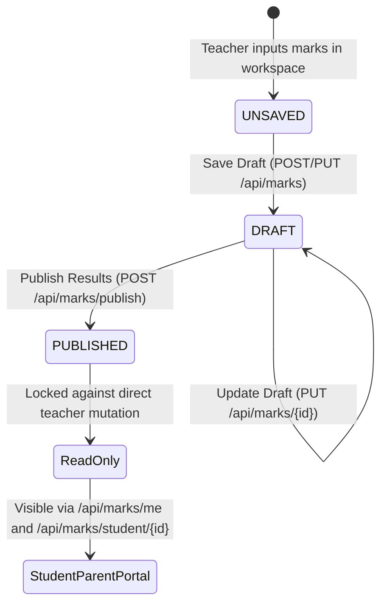

# Feature 02.3: Academic Marks Draft & Publication Workflow

## 1. Overview & Architecture

Feature 02.3 implements an end-to-end, enterprise-grade academic marks publication lifecycle. Building upon the marks foundation (Task 02.1) and teacher marks entry workspace (Task 02.2), this feature introduces a secure publication gateway that transitions saved marks from private `DRAFT` status to immutable `PUBLISHED` status.

### Publication Lifecycle State Machine



- **UNSAVED**: Score entered or modified in the teacher worksheet, tracked as dirty locally.
- **DRAFT**: Saved to MongoDB (`status="DRAFT"`). Editable by authorized teacher. Invisible to students and parents.
- **PUBLISHED**: Finalized marks (`status="PUBLISHED"`). Immutable against direct teacher modification (`409 Conflict`). Immediately accessible to authorized students and linked parents.

---

## 2. API Contracts & Endpoints

### 2.1 Publish Marks Endpoint

- **Endpoint:** `POST /api/marks/publish`
- **Security:** Requires `TEACHER` or `ADMIN` authority. Must pass CSRF verification (`X-XSRF-TOKEN`).
- **Authorization:** Authenticated teacher must be explicitly assigned to `classId` and `subject`.

#### Request Schema (`PublishMarksRequest`):
```json
{
  "classId": "GRADE-10-A",
  "subject": "Mathematics",
  "examId": "exam-101",
  "assessmentType": "CLASS_TEST",
  "term": "Term 1",
  "assessmentId": "CLASS_TEST#Term 1",
  "markIds": ["653a1b...", "653a1c..."],
  "allowPartial": false
}
```

#### Response Schema (`PublishMarksResponse`):
```json
{
  "classId": "GRADE-10-A",
  "subject": "Mathematics",
  "examId": "exam-101",
  "assessmentId": "exam-101",
  "publishedCount": 25,
  "alreadyPublishedCount": 0,
  "totalTargeted": 25,
  "publishedIds": ["653a1b...", "..."],
  "alreadyPublishedIds": [],
  "message": "Successfully published marks for 25 student(s)."
}
```

### 2.2 Teacher Marks Roster Query

- **Endpoint:** `GET /api/marks/class/{classId}/subject/{subject}?examId=...&assessmentType=...&term=...&assessmentId=...`
- **Security:** Requires teacher assignment to `classId` and `subject`.
- **Functionality:** Scopes marks specifically to the assessment event, preventing cross-assessment record collisions.

---

## 3. Authorization Matrix

| Role | Save Draft (`POST/PUT /api/marks`) | Publish Marks (`POST /api/marks/publish`) | View Drafts (`GET /api/marks/class/...`) | View Published Marks |
|---|---|---|---|---|
| **Teacher (Assigned)** | Allowed | Allowed | Allowed | Allowed |
| **Teacher (Unassigned Class/Subject)** | 403 Forbidden | 403 Forbidden | 403 Forbidden | 403 Forbidden |
| **Student** | 403 Forbidden | 403 Forbidden | 403 Forbidden | Allowed (Own records only) |
| **Parent** | 403 Forbidden | 403 Forbidden | 403 Forbidden | Allowed (Linked child only) |
| **Administrator** | Allowed | Allowed | Allowed | Allowed |
| **Unauthenticated** | 401 Unauthorized | 401 Unauthorized | 401 Unauthorized | 401 Unauthorized |

---

## 4. Assessment Identity & Duplicate Protection

### 4.1 Assessment Identity Resolution
To guarantee isolation between exams and continuous classroom assessments without `examId`:
- **Exam-linked:** `assessmentId = examId`
- **Non-exam assessments:** `assessmentId = {assessmentType}#{term}` (e.g. `CLASS_TEST#Term 1`)
- **Compound Index:**
  ```java
  @CompoundIndex(name = "idx_marks_student_subject_assessment",
                 def = "{'studentId': 1, 'subject': 1, 'assessmentId': 1}",
                 unique = true, sparse = true)
  ```

### 4.2 Legacy Backward Compatibility
- Legacy records without `assessmentId` resolve `getEffectiveAssessmentId()` dynamically.
- The sparse index ensures existing legacy documents are unconstrained.
- As records are updated or published, `assessmentId` is backfilled seamlessly.

---

## 5. Data Consistency & Completeness Guarantees

1. **Roster Completeness Enforcement:**
   - By default (`allowPartial=false`), publication validates that all enrolled students in the class have saved marks.
   - If marks are missing, `400 Bad Request` (`INCOMPLETE_ROSTER_MARKS`) is returned.
   - Teachers may explicitly confirm partial publication (`allowPartial=true`) via the UI confirmation modal.
2. **Batch Persistence & Pre-validation:**
   - In-memory validation of context, score range (`0 <= marks <= totalMarks`), and ownership is executed before saving.
   - Updated drafts are persisted in batch via `marksRepository.saveAll(toPublish)`.
3. **Idempotent Retry Policy:**
   - Retrying publication on already-published marks succeeds safely without raising errors (`alreadyPublishedCount` is tracked), making network retries completely safe.

---

## 6. Frontend Workspace Workflow

- **Roster & Scope Scoping:** Automatically queries marks scoped to class, subject, and the selected assessment.
- **Metric Cards:** Live tally of enrolled students, entered scores, saved drafts, published marks, and class average.
- **Row Status Badges:** Visual distinction between `Published` (read-only), `Unsaved Draft` (amber), `Draft Saved` (blue), and `No Score` (slate).
- **Missing Marks Notice:** Prominent alert when students in the roster have not received marks.
- **Publish Action & Confirmation Modal:**
  - Disabled if unsaved changes exist, no drafts exist, or publication is in flight.
  - Modal details: class, subject, assessment title, eligible drafts count, already published count, and missing marks count.
  - Partial publication checkbox required when missing marks are present.
  - Safe error handling: on error or network failure, server state is refreshed so the teacher inspects authoritative state before retrying.

---

## 7. Quality Assurance & Verification

- **Backend:** 169 unit and integration tests passing (`AttendanceAndMarksServiceTest`, `MarksControllerIntegrationTest`).
- **Frontend:** 29 Vitest tests passing (`marksService.test.ts`, `marksValidation.test.ts`).
- **Build & Quality Gates:**
  - TypeScript: 0 errors (`tsc --noEmit`).
  - ESLint: 0 errors, 0 warnings (`--max-warnings=0`).
  - Production build: 47/47 static pages generated.
  - Security audit: 0 critical vulnerabilities.
