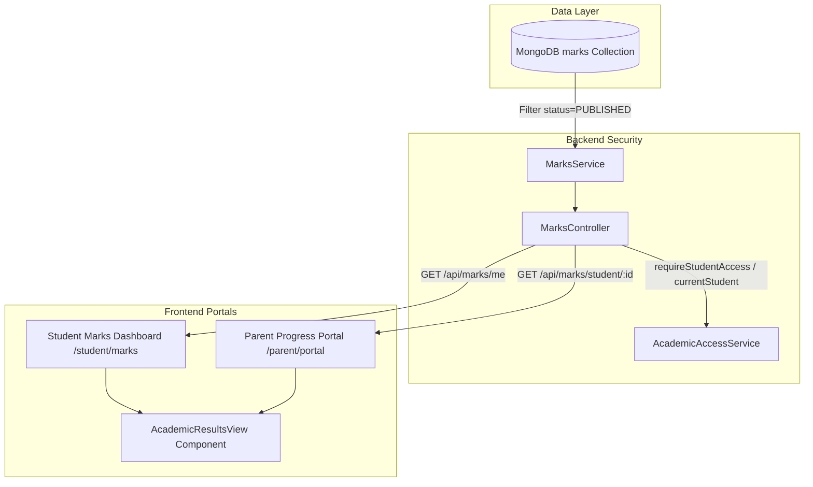

# Feature 02.4: Student & Parent Academic Results and Reporting

## 1. Overview & Architecture

Feature 02.4 delivers a secure, accessible, and responsive academic results experience for students and linked parents. It leverages the verified, published marks repository and backend foundations established in Features 02.1–02.3, completely insulating student and parent portals from unfinalized draft records and unauthorized cross-student data.

### System Architecture & Privacy Boundary

---

## 2. Implemented Pages & Routes

### 2.1 Student Results Page (`/student/marks`)
- **Route:** `GET /student/marks`
- **Component:** `frontend/app/student/marks/page.tsx`
- **Features:**
  - Loads authenticated student profile (`/api/students/me`) and published marks (`/api/marks/me`).
  - Overall performance metrics (Average %, Total Assessments, Best Subject, Subjects count).
  - Subject performance progress visualization with color-graded thresholds (>=75% emerald, >=60% blue, >=40% amber, <40% rose).
  - Filterable by Subject, Term, Assessment Type, and Sort order.
  - Searchable by keyword.
  - Formatted publication timestamps.
  - Client-side RFC 4180 CSV report export.
  - Print-ready CSS styling (`window.print()`).
  - Zero-score support (valid `0%`, not null).

### 2.2 Parent Portal (`/parent/portal`)
- **Route:** `GET /parent/portal`
- **Component:** `frontend/app/parent/portal/page.tsx`
- **Features:**
  - Authenticated parent views only linked children (`/api/parents/children`).
  - Child selection dropdown with instant stale-data clearing.
  - Async sequence tracking (`requestSeq`) preventing race conditions during rapid child switching.
  - Academic Results tab embeds the shared `AcademicResultsView` component for the selected linked child.
  - Maintains existing attendance, assignments, and school announcements tabs.

---

## 3. Shared Component: `AcademicResultsView`

Located at: `frontend/components/academic/AcademicResultsView.tsx`

### Capabilities:
- **Responsive Layout:** Works smoothly on mobile, tablet, and desktop screens.
- **KPI Metrics Cards:** Overall average percentage, total assessments, highest-scoring subject, distinct subject count.
- **Visual Progress Chart:** Real-time CSS percentage bars grouped by subject.
- **Accessible Filter Bar:** Multi-criteria filtering by subject, academic term, assessment category, and score/date sorting.
- **Standardized CSV Export:** Client-side generation of `Academic_Results_{studentName}_{date}.csv` with proper escaping.
- **Print Friendly:** Integrates with browser print engine for paper or PDF generation.

---

## 4. Academic Calculation Methodology

1. **Individual Assessment Percentage:**
   $$\text{Percentage} = \frac{\text{Marks Obtained}}{\text{Total Possible Marks}} \times 100$$
   - Validated: `totalMarks > 0`. If `totalMarks` is zero or missing, percentage is `null` (displayed as `—`).
   - Zero scores: If marks obtained is `0`, percentage evaluates cleanly to `0.0%`.
2. **Overall Academic Average:**
   - Raw scores across assessments with different maximum totals (e.g. 50 vs 100) are **never directly summed** to avoid skewing.
   - Each assessment is normalized to its percentage first, and the overall average represents the arithmetic mean of all valid assessment percentages:
   $$\text{Overall Average} = \text{round}\left(\frac{\sum_{i=1}^{n} \text{Percentage}_i}{n}\right)$$
3. **Subject Averages:**
   - Similarly calculated per distinct subject area to power the performance progress bars.

---

## 5. Security & Authorization Matrix

| Caller | Direct Endpoint | Backend Check | Allowed Records |
|---|---|---|---|
| **Authenticated Student** | `GET /api/marks/me` | `currentStudent(auth)` | Only student's own `PUBLISHED` marks. |
| **Authenticated Student** | `GET /api/marks/student/{id}` | `requireStudentAccess(auth, id)` | Permitted only if `id == student.id`. Others rejected with `403 Forbidden`. |
| **Authenticated Parent** | `GET /api/marks/student/{id}` | `requireStudentAccess(auth, id)` | Permitted only if `id` is a linked child (`parentEmail == auth.name`). Others rejected with `403 Forbidden`. |
| **Unauthenticated User** | Any marks endpoint | Spring Security filter | Rejected with `401 Unauthorized`. |
| **Any Caller (Student/Parent)** | Any endpoint | `MarksService` | Draft marks are strictly filtered out at query level. |

---

## 6. Verification & Quality Gates

- **Backend Tests:** 172 unit & integration tests passing (`AttendanceAndMarksServiceTest`, `MarksControllerIntegrationTest`).
- **Frontend Tests:** 38 unit tests passing across 9 test files (`studentMarks.test.ts`, `parentPortal.test.ts`, `marksService.test.ts`, `marksValidation.test.ts`, etc.).
- **Linting & Types:**
  - TypeScript: 0 errors (`tsc --noEmit`).
  - ESLint: 0 errors, 0 warnings (`eslint . --max-warnings=0`).
- **Next.js Production Build:** 47/47 static routes compiled successfully.
- **Security Audit:** 0 critical vulnerabilities.
- **ML Service:** 11/11 pytest tests passing.
- **Infrastructure:** Docker Compose configuration valid.

---

## 7. Remaining Feature 02 Tasks

- **Task 02.5:** Integration & Comprehensive End-to-End Testing (Final Feature 02 verification PR).
