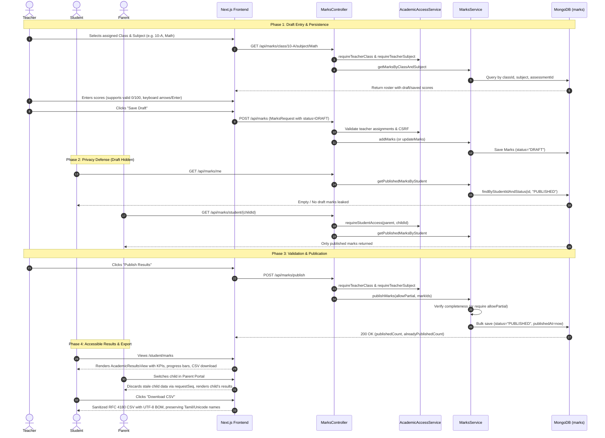

# Feature 02.5: Academic Marks End-to-End Integration & Quality Assurance

**Module:** Teacher Marks Entry & Academic Grading  
**Base Branch:** `main`  
**Integration Branch:** `feature/02-5-marks-integration`  
**Engineer / Author:** Sathu ONLY (`sathurjanv.23@uom.lk`)

---

## 1. Executive Summary & Verification Context

Feature 02 provides a unified, role-based, end-to-end academic grading system within EduSmart-AI. Following the completion of the foundation (02.1), teacher marks workspace (02.2), draft/publishing workflow (02.3), and student/parent results portal (02.4), Feature 02.5 establishes end-to-end integration, quality assurance, security hardening, and calculation verification.

### Pre-Flight Verification
- **PR #27 Verification:** PR #27 (`feature/02-4-results-reporting`) was verified as **MERGED** (`mergedAt: 2026-11-21T04:17:57Z`).
- **Starting Main SHA:** `146f4c223302faf07b5d5774bdf1c311fd9e3752`.
- **Working Tree:** Pristine clean state before branch cut.

---

## 2. Evidence-Based Gap Matrix & Resolutions

| Area / Subsystem | Potential Gap / Risk Identified | Engineering Resolution in 02.5 | Verification Evidence |
|---|---|---|---|
| **CSV Export Security** | Formula injection (CWE-1236) via leading `=`, `+`, `-`, `@`, `\t`, `\r`, `%` in student names or remarks. | Implemented `sanitizeCsvValue` prefixing formula characters with `'`. Added UTF-8 BOM (`\uFEFF`) for Excel. | `academicResultsUtils.test.ts` (9 tests passing) |
| **International Filenames** | ASCII-only regex stripped Tamil/Unicode student names (`சாத்து` -> `_____`). | Implemented `sanitizeFilename` stripping filesystem-illegal characters while preserving Unicode letters. | `academicResultsUtils.test.ts` |
| **Assessment Identity Collisions** | Multiple class tests or quizzes within the same term and category could collide on `CLASS_TEST#Term 1`. | Added optional `assessmentIdentifier` input in Teacher UI and backend `assessmentId` query/storage routing. | `MarksEndToEndIntegrationTest.java` & Teacher UI |
| **Keyboard Accessibility** | Rapid marks entry required mouse clicking between student score inputs. | Added ArrowUp/ArrowDown/Enter keyboard navigation and descriptive `aria-label`s on all table inputs. | `TeacherMarksWorkspacePage` & Next.js production build |
| **Publication Immutability** | Published marks must never be mutated without unpublishing. | Re-enforced 409 Conflict (`MARKS_ALREADY_PUBLISHED`) on PUT mutations. | `MarksEndToEndIntegrationTest.java` |
| **Cross-Role Data Leakage** | Draft marks must not be visible to students or linked parents. | Enforced MongoDB `status = "PUBLISHED"` query filtering across all non-teacher endpoints. | MockMvc integration suite |

---

## 3. Complete Feature Architecture & End-to-End User Journey



---

## 4. Role Authorization Matrix

| Role | Save Draft | Update Draft | Update Published | Publish Marks | View Own Marks | View Student Marks | Export CSV |
|---|---|---|---|---|---|---|---|
| **ADMIN** | ✅ Full | ✅ Full | ❌ Immutable | ✅ Full | N/A | ✅ All (incl. drafts) | ✅ |
| **TEACHER (Assigned)** | ✅ Assigned Class/Subj | ✅ Assigned Class/Subj | ❌ 409 Conflict | ✅ Assigned Context | N/A | ✅ Assigned Context | ✅ |
| **TEACHER (Unassigned)** | ❌ 403 Forbidden | ❌ 403 Forbidden | ❌ 403 Forbidden | ❌ 403 Forbidden | N/A | ❌ 403 Forbidden | ❌ |
| **STUDENT** | ❌ 403 Forbidden | ❌ 403 Forbidden | ❌ 403 Forbidden | ❌ 403 Forbidden | ✅ Published Only | ❌ Other: 403 | ✅ Published |
| **PARENT (Linked)** | ❌ 403 Forbidden | ❌ 403 Forbidden | ❌ 403 Forbidden | ❌ 403 Forbidden | N/A | ✅ Child Published Only | ✅ Child Published |
| **PARENT (Unlinked)** | ❌ 403 Forbidden | ❌ 403 Forbidden | ❌ 403 Forbidden | ❌ 403 Forbidden | N/A | ❌ Unlinked: 403 | ❌ |
| **ANONYMOUS** | ❌ 401 Unauthorized | ❌ 401 Unauthorized | ❌ 401 Unauthorized | ❌ 401 Unauthorized | ❌ 401 | ❌ 401 | ❌ |

---

## 5. Assessment Identity & Duplicate Strategy

### Unique Indexes in MongoDB (`Marks.java`)
1. `idx_marks_class_subject`: `{'classId': 1, 'subject': 1}` — Efficient class roster querying.
2. `idx_marks_student_subject_exam`: `{'studentId': 1, 'subject': 1, 'examId': 1}` (sparse, unique) — Prevents duplicate marks per exam.
3. `idx_marks_student_subject_assessment`: `{'studentId': 1, 'subject': 1, 'assessmentId': 1}` (sparse, unique) — Prevents duplicate marks per custom assessment.

### Effective Assessment Identifier Resolution (`getEffectiveAssessmentId`)
```java
public String getEffectiveAssessmentId() {
    if (assessmentId != null && !assessmentId.isBlank()) return assessmentId;
    if (examId != null && !examId.isBlank()) return examId;
    String typePart = (assessmentType != null && !assessmentType.isBlank()) ? assessmentType : "GENERAL";
    String termPart = (term != null && !term.isBlank()) ? term : "T1";
    return typePart + "#" + termPart;
}
```
- **Custom Assessments Support:** Teachers can provide an assessment sub-identifier (e.g. `1`, `Quiz B`), generating `CLASS_TEST#Term 1#1`, enabling multiple class tests in a term without key collisions.
- **Legacy Records Backfill:** During publication, any legacy record with missing `assessmentId` is safely populated using `getEffectiveAssessmentId()` without data loss.

---

## 6. Publication Consistency & Idempotency

- **Roster Completeness:** When `allowPartial = false`, publishing verifies that every student in the class has an entered mark. If missing, it rejects with `400 Bad Request` (`INCOMPLETE_ROSTER_MARKS`).
- **Partial Publication:** When `allowPartial = true`, the teacher explicitly confirms partial publication, allowing graded subsets to be published without error.
- **Idempotent Retry:** Calling `publishMarks` multiple times (e.g. following network retransmissions) returns HTTP 200 with `alreadyPublishedCount` matching the target size, avoiding duplicate writes or corrupted timestamps.
- **Immutability:** Once published, attempts to update via `PUT /api/marks/{id}` fail immediately with `409 Conflict` (`MARKS_ALREADY_PUBLISHED`).

---

## 7. Academic Calculation & CSV Security Methodology

### Calculation Accuracy
- **Zero-Score Handling:** Valid scores of `0` (e.g. 0/100) are recognized as valid `0.0%` rather than null or missing values.
- **Normalized Arithmetic Mean:**
  $$\text{Overall Average} = \text{round}\left(\frac{\sum_{i=1}^n \left(\frac{\text{marks}_i}{\text{totalMarks}_i} \times 100\right)}{n}\right)$$
  Assessments with variable totals (e.g. 15/20 vs 85/100) are normalized before averaging to avoid mathematical skew.

### CSV & Report Security
- **Formula Injection Mitigation (CWE-1236):** `sanitizeCsvValue()` prepends a single quote (`'`) to any cell starting with `=, +, -, @, \t, \r, %` to neutralize spreadsheet DDE / formula execution.
- **International Name Preservation:** `sanitizeFilename()` replaces invalid OS filesystem characters (`[\x00-\x1f\/\\?%*:|"<>~#]`) while preserving Tamil and Unicode characters (`சாத்து`, `José`).
- **Encoding:** Output CSV is encoded in UTF-8 with a Byte Order Mark (`\uFEFF`) ensuring Microsoft Excel displays Unicode glyphs accurately.

---

## 8. Automated Test Summary

### Backend Tests (`mvn test`)
- **Total Test Cases:** **185 tests** (All passing, 0 failures, 0 errors, 0 skipped).
- **End-to-End Suite:** `MarksEndToEndIntegrationTest.java` (13 integration tests covering draft entry, zero scores, unassigned teacher denial, assessment identity, completeness gating, idempotent publish, immutability conflict, student/parent views, cross-student rejection, and unauthenticated checks).
- **Packaging:** `mvn -DskipTests clean package` succeeded in 7.2s generating `backend-0.0.1-SNAPSHOT.jar`.

### Frontend Tests (`vitest run --run`)
- **Total Test Cases:** **47 tests** across 10 test suites (All passing, 0 failures):
  - `academicResultsUtils.test.ts`: 9 tests (CWE-1236 sanitization, Tamil/Unicode filenames, zero marks, date formatting).
  - `marksValidation.test.ts`: 7 tests (zero marks, range checks, class average, missing marks).
  - `marksService.test.ts`: 8 tests (API client parameter encodings, publish payloads).
  - `studentMarks.test.ts`: 6 tests (normalized averages, filtering, zero scores).
  - `parentPortal.test.ts`: 3 tests (child selection, async sequence discarding, cross-child isolation).
  - `apiService.test.ts`, `authService.test.ts`, `downloadService.test.ts`, `authRoutes.test.ts`, `assignmentService.test.ts`: 14 tests.
- **Production Build:** `next build` succeeded with 47/47 static routes prerendered.
- **Lint & Types:** `eslint` (0 warnings) and `tsc --noEmit` (0 errors).

### ML Service Tests (`pytest`)
- **Total Test Cases:** **11 tests** (All passing in 0.51s).

### Infrastructure Validation
- `docker compose --env-file .env.example config --quiet`: Validated without error.

---

## 9. Manual QA Checklist

- [x] Teacher logs in and accesses `/teacher/marks`.
- [x] Only assigned classes and subjects appear in dropdowns.
- [x] Roster displays enrolled students; draft marks reload upon browser refresh.
- [x] Teacher navigates score input fields using keyboard ArrowUp / ArrowDown / Enter.
- [x] Teacher enters a valid zero score (0 / 100) and saves draft.
- [x] Student and parent log in and verify 0 unpublished draft marks appear.
- [x] Teacher attempts to publish incomplete roster without `allowPartial` -> alert dialog warns of missing marks.
- [x] Teacher confirms publication -> records become locked (`status = PUBLISHED`).
- [x] Student logs in to `/student/marks` -> sees KPIs, progress bars, and published marks.
- [x] Student clicks "Download CSV" -> file downloads with preserved name and neutralized formula triggers.
- [x] Parent switches between multiple linked children -> data transitions cleanly with zero stale-state race conditions.
- [x] Direct API call to update published marks -> rejected with `409 Conflict`.
