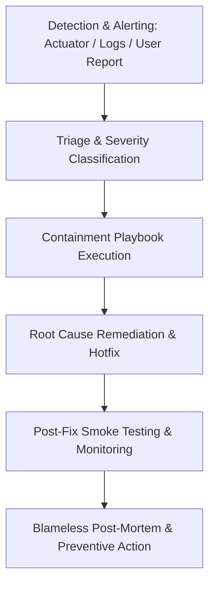

# CampusCore Incident Response & Outage Management Playbook

**Document Version:** 1.0.0  
**Lead Security Engineer:** Sathu  
**Repository:** [EduSmart-AI](https://github.com/Sathurjanv23/EduSmart-AI)  

---

## 1. Incident Severity Levels & Response Targets

| Severity | Definition | Examples | Target Response | Target Resolution |
| :--- | :--- | :--- | :--- | :--- |
| **P1 - Critical** | Catastrophic outage or confirmed active data breach | JWT private key compromised, complete site down during exams, unauthenticated student record dump | $\le$ 15 minutes | $\le$ 2 hours |
| **P2 - Major** | Core academic feature degraded without immediate workaround | Attendance or marks submission down school-wide, login OTP delivery failing for all users | $\le$ 30 minutes | $\le$ 6 hours |
| **P3 - Moderate** | Non-critical feature failure with available workaround | ML risk predictions failing, report card PDF generation delays | $\le$ 2 hours | $\le$ 24 hours |
| **P4 - Low** | Minor cosmetic defect or isolated low-severity bug | UI text formatting error, non-blocking warning in dev console | $\le$ 1 business day | Next release cycle |

---

## 2. Incident Response Workflow



---

## 3. Containment & Remediation Playbooks

### Playbook 3.1: JWT Secret Compromise & Secret Rotation Runbook
**Trigger**: Suspected or confirmed leakage of `JWT_SECRET` (e.g. accidental git commit, leaked logs, host compromise).

#### Execution Steps:
1. **Generate New Cryptographic Secret**:
   ```bash
   NEW_JWT_SECRET=$(openssl rand -hex 32)
   ```
2. **Update Environment Secret**:
   Update `JWT_SECRET` in `.env.production` or your cloud secret manager (AWS Secrets Manager / Vault).
3. **Execute Rolling Restart of Backend Instances**:
   ```bash
   docker compose restart backend
   ```
4. **Security Effect**:
   - Because tokens are HMAC-SHA256 signed with `JWT_SECRET`, rotating the secret instantly invalidates every previously issued token across the system.
   - All active sessions are terminated immediately.
   - Attackers holding the leaked secret can no longer forge signatures or use existing session cookies.
5. **User Communication**:
   Broadcast notification advising students, parents, and staff to log in again.

---

### Playbook 3.2: Database Credential Compromise & Rotation
**Trigger**: Unauthorized access alerts or exposure of `MONGODB_URI` credentials.

#### Execution Steps:
1. **Provision Temporary Secondary User in MongoDB Atlas**:
   - Create user `campuscore_temp` with role `readWrite` on `smsdb_prod`.
2. **Update Application Configuration**:
   - Update `MONGODB_URI` to use `campuscore_temp` credentials.
   - Restart backend service.
3. **Revoke Compromised Credentials**:
   - Immediately delete or rotate the password of the compromised MongoDB user in Atlas.
4. **Audit Database Access Logs**:
   - Inspect Atlas access history for abnormal IP connections or unauthorized query volumes.

---

### Playbook 3.3: Active Credential Stuffing or Brute-Force Attack
**Trigger**: Spike in `401 Unauthorized` or `429 Too Many Requests` on `/api/auth/login` or `/api/auth/verify-otp`.

#### Execution Steps:
1. **Identify Offending IP Addresses via Correlation Logs**:
   ```bash
   docker compose logs backend | grep "429" | awk '{print $NF}' | sort | uniq -c | sort -nr
   ```
2. **Temporary Edge Block**:
   - Block malicious IP ranges at edge reverse proxy (Nginx / Cloudflare WAF / AWS WAF).
3. **Verify Rate Limiting Guard**:
   - Confirm `RateLimitService.java` is enforcing login/OTP bucket limits (`LOGIN_RATE_LIMIT=5`, `OTP_MAX_ATTEMPTS=5`).
4. **Notify Affected Accounts**:
   - Send security alert emails to users whose accounts were repeatedly targeted.

---

## 4. Blameless Post-Mortem & Incident Documentation

Within 48 hours of resolving any P1 or P2 incident, the engineering team must publish a blameless post-mortem covering:
1. **Incident Summary**: Exact timeline of events (detection, containment, recovery).
2. **Root Cause Analysis (5 Whys)**: Underlying technical or process failure.
3. **Impact Assessment**: Number of affected student/teacher accounts, downtime duration.
4. **Corrective & Preventive Actions**: Action items assigned to prevent recurrence with target completion dates.
