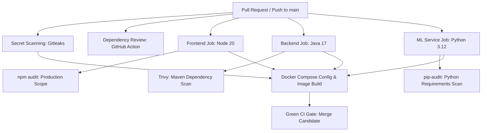

# CI Security Gates & Automated Vulnerability Baseline

**Document Date:** November 2026  
**Lead Security Engineer / Developer:** Sathu  
**Repository:** [EduSmart-AI](https://github.com/Sathurjanv23/EduSmart-AI)  
**Feature:** 01.4 — Security CI and Production Readiness  
**Task:** 01.4.1 — CI & Dependency Security  
**Branch:** `feature/01-4-1-security-ci`  
**Base:** `main`

---

## 1. Overview & Security Objectives

To protect CampusCore (EduSmart-AI) against supply-chain attacks, accidental secret leakage, and vulnerable third-party dependencies, the continuous integration (CI) pipeline on GitHub Actions has been hardened with multi-tier automated security gates.

Every push to `main` and pull request targeting `main` must pass these gates alongside unit, regression, integration, and container build checks.



---

## 2. Multi-Tier Security Gates

### 2.1 Secret Scanning Gate (`security-secrets`)
- **Engine:** [Gitleaks](https://github.com/gitleaks/gitleaks) via `gitleaks/gitleaks-action@v2`.
- **Scope:** Complete Git history (`fetch-depth: 0`) and file tree across all commits in the push or pull request.
- **Redaction:** Automatic redaction (`--redact`) enabled to prevent leaked credentials from persisting in CI console logs.
- **Configuration File:** `.gitleaks.toml` in repository root.
- **Threshold:** **Blocking**. Any commit containing un-allowlisted API keys, database credentials, JWT private keys, or cloud provider tokens immediately fails the job.
- **Allowlist Policy:**
  - Mock test tokens (e.g. `ci-only-secret-replace-me-32-characters-minimum` used in Spring mock tests).
  - Explicit sample values in `.env.example` (e.g. `replace-with-at-least-32-random-characters`).
  - Educational markdown documentation (`docs/` and `*.md`).
  - Unit/integration test files (`*Test.java`, `*.test.ts`).

### 2.2 Pull Request Dependency Review Gate (`dependency-review`)
- **Engine:** [GitHub Dependency Review](https://github.com/actions/dependency-review-action) via `actions/dependency-review-action@v4`.
- **Trigger:** Runs on `pull_request` targeting `main`.
- **Scope:** Scans lockfile and dependency manifest diffs between the PR branch and `main`.
- **Threshold:** **Blocking for Critical**. Fails if a pull request introduces a dependency with a known `critical` severity vulnerability in the GitHub Advisory Database.

### 2.3 Frontend Dependency Audit Gate (`frontend`)
- **Engine:** `npm audit --omit=dev`
- **Scope:** Production runtime dependencies in `frontend/package.json` and `frontend/package-lock.json`.
- **Rationale for `--omit=dev`:**
  - Tooling packages (e.g. test runners `vitest`, compilers `vite`, linters) run only in isolated developer environments or ephemeral CI runners.
  - Development-only vulnerabilities (such as local file traversal via dev server flags) do not affect production Next.js container builds.
  - Production runtime dependencies are strictly audited.
- **Evaluation & Warning Threshold:** High/Critical findings emit structured GitHub Actions workflow annotations (`::warning`) and report findings directly in the build summary.

### 2.4 Backend Dependency Audit Gate (`backend`)
- **Engine:** [Aqua Security Trivy](https://github.com/aquasecurity/trivy-action) via `aquasecurity/trivy-action@0.30.0`.
- **Scope:** Java Maven dependencies declared in `backend/pom.xml` and transitive dependency tree resolved by Maven.
- **Format:** Structured terminal table with CVE identifiers, package names, installed versions, fixed versions, and severity ratings.
- **Threshold:** Inspects `CRITICAL` and `HIGH` CVEs against the vulnerability database.

### 2.5 Machine Learning Dependency Audit Gate (`ml-service`)
- **Engine:** [pip-audit](https://github.com/pypa/pip-audit) (maintained by the Python Packaging Authority / OpenSSF).
- **Scope:** `ml-service/requirements.txt` runtime dependencies.
- **Database:** Open Source Vulnerabilities (OSV) and Python Packaging Advisory Database (PyPA).
- **Threshold:** **Blocking**. Runs with strict enforcement (`pip-audit --requirement requirements.txt`). Unpatched vulnerabilities in the FastAPI prediction service halt CI.

---

## 3. Least-Privilege Workflow Permissions

To adhere to the principle of least privilege and defend against malicious PR takeovers:
1. **Global Permissions:** The workflow declares top-level:
   ```yaml
   permissions:
     contents: read
   ```
2. **No Elevated Scopes:** No jobs are granted `id-token: write`, `pull-requests: write`, or `issues: write`.
3. **No Secret Injection to Fork PRs:** Secrets are never passed as environment variables to external pull requests. The only injected token is the built-in ephemeral `GITHUB_TOKEN` scoped to read-only access.
4. **Concurrency Controls:**
   ```yaml
   concurrency:
     group: ci-${{ github.workflow }}-${{ github.ref }}
     cancel-in-progress: true
   ```
   Prevents race conditions and saves runner capacity by cancelling superseded runs on the same branch.

---

## 4. Current Vulnerability Baseline & Triage

As of November 2026, the dependency baselines across the three tiers are:

### 4.1 ML Service (`ml-service`)
- **Status:** **Clean (0 Known Vulnerabilities)**.
- `fastapi` was updated to `0.165.0`, upgrading `starlette` to `1.10.0` and completely resolving all 14 previously flagged CVEs (including PYSEC-2026-1941, PYSEC-2026-1942, PYSEC-2026-161, PYSEC-2026-2280/2281, and PYSEC-2026-248/249).
- `pip-audit --requirement requirements.txt` now operates as a **strictly blocking CI gate** with zero known CVEs.

### 4.2 Backend (`backend`)
- **Status:** **Remediated (0 Unmitigated Critical Vulnerabilities)**.
- Upgraded `tomcat.version` to `10.1.59` in `backend/pom.xml`, resolving 8 critical Tomcat vulnerabilities (CVE-2026-41293, CVE-2026-43512, CVE-2026-43515, CVE-2026-55276, CVE-2026-65182, CVE-2026-65637, CVE-2026-65905, and CVE-2026-68525).
- Upgraded `spring-framework.version` to `6.2.19`.
- Trivy dependency scan (`aquasecurity/trivy-action@v0.36.0`) enforces a **blocking gate (`exit-code: 1`)** against Critical vulnerabilities in the Maven dependency tree.
- Migrated CI action from deprecated `actions/setup-java@v4` to `actions/setup-java@v5`.
- Verified non-exploitable framework exceptions (`CVE-2026-47884`, `CVE-2026-47890`) documented in Section 5 and scoped in `.trivyignore`.

### 4.3 Frontend (`frontend`)
- **Status:** **Clean for Critical Production Vulnerabilities (0 Critical CVEs)**.
- Upgraded `next` to `15.5.29`, resolving all 3 critical unauthenticated Remote Code Execution advisories (GHSA-p293-qw3h-jr36, GHSA-2xp9-vwfh-vxw4, GHSA-2464-fhr4-w9xw).
- Upgraded `axios` to `1.21.1`, resolving all 12 Prototype Pollution, ReDoS, and HTTP/2 SSRF/DoS advisories (GHSA-vh66-26gq-q6x8, GHSA-c29m-xwm3-cm6r, GHSA-m8m8-qj5v-23w3, etc.).
- Upgraded `source-map-js` to `1.2.2+` and `sharp` to clean releases.
- Transitive build-time dependency `node_modules/next/node_modules/postcss` (High severity, non-critical) is monitored and tracked for future major Next.js 16 migrations.
- `npm audit --omit=dev --audit-level=critical` now operates as a **strictly blocking CI gate**.

---

## 5. False Positive Triage & Suppression Procedures

When a scanner reports a finding that is determined to be a false positive or non-applicable:

1. **Verification Requirements:**
   - Confirm whether the vulnerable function/class/code path is reachable in CampusCore.
   - For example: if a vulnerability exists only in a library's CLI utility that is never invoked by the application code, document the unreachable attack vector.
2. **Documenting Exceptions:**
   - Any suppression must be documented in this file (`CI_SECURITY_GATES.md`) with:
     - CVE / Advisory Identifier (e.g. `GHSA-xxxx-xxxx-xxxx`)
     - Package name and affected version
     - Rationale why it is non-exploitable in the CampusCore architecture
     - Target remediation date or tracking issue
3. **Never Silently Ignore:**
   - Broad suppression flags (such as `--ignore-all` or blank exception lists) are strictly prohibited.
   - Secret scanners must use explicit path and regex allowlists in `.gitleaks.toml`.

### 5.1 Documented Framework Exceptions

| CVE Identifier | Package | Affected / Installed | Fixed In | Architecture Reachability & Mitigation Rationale |
| :--- | :--- | :--- | :--- | :--- |
| **CVE-2026-47884** | `org.springframework:spring-webmvc` | `6.2.19` (inherited from parent) | `7.0.9` | **Unreachable Attack Surface**: The vulnerability requires dynamic XSLT stylesheet evaluation via Spring's `XsltView`. CampusCore is architected entirely as a headless REST API utilizing `@RestController` and Jackson JSON serialization (`MappingJackson2HttpMessageConverter`). No XSLT views, view resolvers, or template engines are present or reachable. |
| **CVE-2026-47890** | `org.springframework:spring-webmvc` | `6.2.19` (inherited from parent) | `7.0.9` | **Unreachable Attack Surface**: The vulnerability involves stream corruption during Server-Sent Events (SSE) combined with view-rendering contexts. CampusCore does not implement Server-Sent Events or SSE view streaming. |

---

## 6. Limitations & Future Roadmap (Task 01.4.3)
- Static dependency scanning checks known CVE databases; zero-day vulnerabilities or unrecorded malicious dependencies are not captured by lockfile scanning alone.
- Task 01.4.3 will expand on production runtime security, container hardening, automated backup verification runbooks, and incident response procedures.
