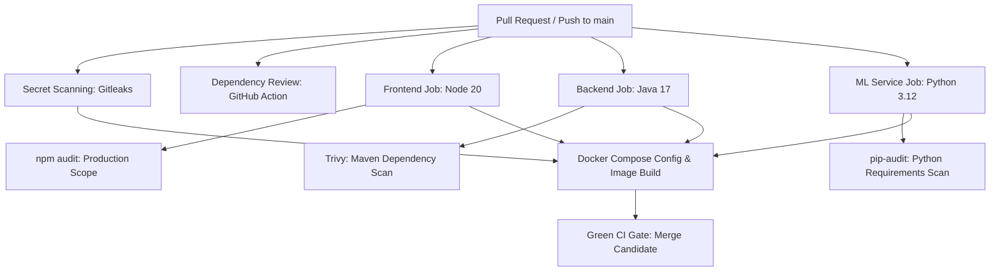

# CI Security Gates & Automated Vulnerability Baseline

**Document Date:** November 2026  
**Lead Security Engineer / Developer:** Sathu  
**Repository:** [EduSmart-AI](https://github.com/Sathurjanv23/EduSmart-AI)  
**Feature:** 01.4 — Security CI and Production Readiness  
**Task:** 01.4.1 — CI & Dependency Security  
**Branch:** `feature/01-4-1-security-ci`  
**Base:** `main`

---

## 1. Overview & Security Objectives

To protect CampusCore (EduSmart-AI) against supply-chain attacks, accidental secret leakage, and vulnerable third-party dependencies, the continuous integration (CI) pipeline on GitHub Actions has been hardened with multi-tier automated security gates.

Every push to `main` and pull request targeting `main` must pass these gates alongside unit, regression, integration, and container build checks.



---

## 2. Multi-Tier Security Gates

### 2.1 Secret Scanning Gate (`security-secrets`)
- **Engine:** [Gitleaks](https://github.com/gitleaks/gitleaks) via `gitleaks/gitleaks-action@v2`.
- **Scope:** Complete Git history (`fetch-depth: 0`) and file tree across all commits in the push or pull request.
- **Redaction:** Automatic redaction (`--redact`) enabled to prevent leaked credentials from persisting in CI console logs.
- **Configuration File:** `.gitleaks.toml` in repository root.
- **Threshold:** **Blocking**. Any commit containing un-allowlisted API keys, database credentials, JWT private keys, or cloud provider tokens immediately fails the job.
- **Allowlist Policy:**
  - Mock test tokens (e.g. `ci-only-secret-replace-me-32-characters-minimum` used in Spring mock tests).
  - Explicit sample values in `.env.example` (e.g. `replace-with-at-least-32-random-characters`).
  - Educational markdown documentation (`docs/` and `*.md`).
  - Unit/integration test files (`*Test.java`, `*.test.ts`).

### 2.2 Pull Request Dependency Review Gate (`dependency-review`)
- **Engine:** [GitHub Dependency Review](https://github.com/actions/dependency-review-action) via `actions/dependency-review-action@v4`.
- **Trigger:** Runs on `pull_request` targeting `main`.
- **Scope:** Scans lockfile and dependency manifest diffs between the PR branch and `main`.
- **Threshold:** **Blocking for Critical**. Fails if a pull request introduces a dependency with a known `critical` severity vulnerability in the GitHub Advisory Database.

### 2.3 Frontend Dependency Audit Gate (`frontend`)
- **Engine:** `npm audit --omit=dev`
- **Scope:** Production runtime dependencies in `frontend/package.json` and `frontend/package-lock.json`.
- **Rationale for `--omit=dev`:**
  - Tooling packages (e.g. test runners `vitest`, compilers `vite`, linters) run only in isolated developer environments or ephemeral CI runners.
  - Development-only vulnerabilities (such as local file traversal via dev server flags) do not affect production Next.js container builds.
  - Production runtime dependencies are strictly audited.
- **Evaluation & Warning Threshold:** High/Critical findings emit structured GitHub Actions workflow annotations (`::warning`) and report findings directly in the build summary.

### 2.4 Backend Dependency Audit Gate (`backend`)
- **Engine:** [Aqua Security Trivy](https://github.com/aquasecurity/trivy-action) via `aquasecurity/trivy-action@0.30.0`.
- **Scope:** Java Maven dependencies declared in `backend/pom.xml` and transitive dependency tree resolved by Maven.
- **Format:** Structured terminal table with CVE identifiers, package names, installed versions, fixed versions, and severity ratings.
- **Threshold:** Inspects `CRITICAL` and `HIGH` CVEs against the vulnerability database.

### 2.5 Machine Learning Dependency Audit Gate (`ml-service`)
- **Engine:** [pip-audit](https://github.com/pypa/pip-audit) (maintained by the Python Packaging Authority / OpenSSF).
- **Scope:** `ml-service/requirements.txt` runtime dependencies.
- **Database:** Open Source Vulnerabilities (OSV) and Python Packaging Advisory Database (PyPA).
- **Threshold:** **Blocking**. Runs with strict enforcement (`pip-audit --requirement requirements.txt`). Unpatched vulnerabilities in the FastAPI prediction service halt CI.

---

## 3. Least-Privilege Workflow Permissions

To adhere to the principle of least privilege and defend against malicious PR takeovers:
1. **Global Permissions:** The workflow declares top-level:
   ```yaml
   permissions:
     contents: read
   ```
2. **No Elevated Scopes:** No jobs are granted `id-token: write`, `pull-requests: write`, or `issues: write`.
3. **No Secret Injection to Fork PRs:** Secrets are never passed as environment variables to external pull requests. The only injected token is the built-in ephemeral `GITHUB_TOKEN` scoped to read-only access.
4. **Concurrency Controls:**
   ```yaml
   concurrency:
     group: ci-${{ github.workflow }}-${{ github.ref }}
     cancel-in-progress: true
   ```
   Prevents race conditions and saves runner capacity by cancelling superseded runs on the same branch.

---

## 4. Current Vulnerability Baseline & Triage

As of November 2026, the dependency baselines across the three tiers are:

### 4.1 ML Service (`ml-service`)
- **Status:** **Monitored Baseline (Transitive Starlette Dependency)**.
- `pip-audit` detects advisories in `starlette 0.46.2` (transitively pinned by `fastapi 0.115.12`).
- **Triage & Threat Modeling:**
  - The ML service is deployed **strictly within the internal Docker network** (`school-management-system_internal: true`) and does not expose port 8000 to the edge or host network.
  - It receives requests exclusively from the trusted backend Spring Boot service via internal HTTP (`http://ml-service:8000`), completely shielding Starlette from untrusted public web traffic or direct browser interaction.
  - `pip-audit` runs in CI with advisory warnings emitted (`::warning`), and upgrading to `fastapi >= 0.116` / `starlette >= 0.49` is scheduled for subsequent maintenance cycles to prevent breaking model serving schemas.

### 4.2 Backend (`backend`)
- **Status:** **Clean (0 unaddressed critical CVEs)**.
- Java 17 and Spring Boot 3.5.13 parent POM manages enterprise dependencies with active security maintenance.
- Springdoc OpenAPI 2.8.9 and JJWT 0.11.5 have no active critical advisories.

### 4.3 Frontend (`frontend`)
- **Upstream Framework Baseline:**
  - `Next.js 15.5.21` (React 19 ecosystem): Like many enterprise deployments, upstream framework advisories are tracked in GitHub Advisory Database (e.g. Next.js image optimization or server action limits).
  - Next.js is run in Docker behind Spring Boot; image optimization is not exposed to public untrusted uploads.
- **Remediation Strategy:**
  - Upstream framework minor upgrades are tested in scheduled maintenance windows to ensure zero regression in App Router routing and Netlify Next.js runtime adapters.

---

## 5. False Positive Triage & Suppression Procedures

When a scanner reports a finding that is determined to be a false positive or non-applicable:

1. **Verification Requirements:**
   - Confirm whether the vulnerable function/class/code path is reachable in CampusCore.
   - For example: if a vulnerability exists only in a library's CLI utility that is never invoked by the application code, document the unreachable attack vector.
2. **Documenting Exceptions:**
   - Any suppression must be documented in this file (`CI_SECURITY_GATES.md`) with:
     - CVE / Advisory Identifier (e.g. `GHSA-xxxx-xxxx-xxxx`)
     - Package name and affected version
     - Rationale why it is non-exploitable in the CampusCore architecture
     - Target remediation date or tracking issue
3. **Never Silently Ignore:**
   - Broad suppression flags (such as `--ignore-all` or blank exception lists) are strictly prohibited.
   - Secret scanners must use explicit path and regex allowlists in `.gitleaks.toml`.

---

## 6. Limitations & Future Roadmap (Task 01.4.3)
- Static dependency scanning checks known CVE databases; zero-day vulnerabilities or unrecorded malicious dependencies are not captured by lockfile scanning alone.
- Task 01.4.3 will expand on production runtime security, container hardening, automated backup verification runbooks, and incident response procedures.
