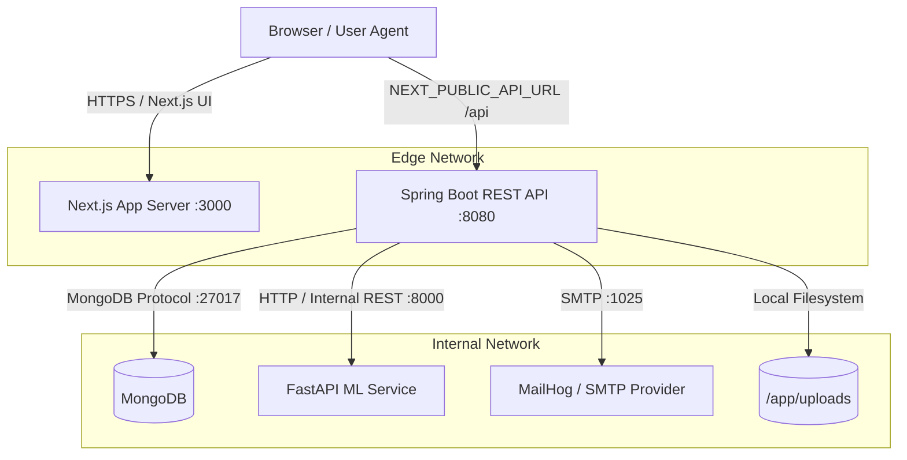

# Feature 01 Security Audit & Regression Baseline

**Audit Date:** November 2026  
**Auditor / Lead Engineer:** Sathu  
**Repository:** [EduSmart-AI](https://github.com/Sathurjanv23/EduSmart-AI)  
**Feature Branch:** `feature/01-1-security-audit`  
**Base Branch:** `main`

---

## 1. Executive Summary

CampusCore (EduSmart-AI) is a multi-role educational operations platform built around four primary authenticated roles: `ADMIN`, `TEACHER`, `STUDENT`, and `PARENT`. The stack comprises:
- **Frontend:** Next.js 15 (App Router), React 19, TypeScript, Tailwind CSS, Axios.
- **Backend API:** Java 17, Spring Boot 3.5, Spring Security 6, Spring Data MongoDB.
- **ML Risk Service:** Python 3.12, FastAPI, scikit-learn, joblib.
- **Infrastructure / Data:** MongoDB 7.0, MailHog (SMTP), Docker Compose.

This security audit inspects the existing authentication mechanisms, session management, role-based authorization, record-level access control, file upload security, error handling, and API route definitions. It establishes a verified characterization test suite to lock in existing authorization behavior before upcoming hardening tasks.

---

## 2. Architecture & Trust Boundaries

### Trust Boundary Analysis
1. **Public Edge vs. Internal Network:**
   - In Docker Compose, only Frontend (`:3000`), Backend (`:8080`), and MailHog Web UI (`:8025`) are exposed to the host.
   - The FastAPI ML service (`:8000`) and MailHog SMTP (`:1025`) are isolated on the internal Docker network. Browser requests cannot directly access ML prediction APIs without passing through Spring Boot authentication and authorization.
2. **Stateless Gateway:**
   - Spring Boot acts as the authoritative security boundary. Client-side state in Next.js is treated as untrusted presentation state.

---

## 3. Detailed Audit Findings

### 3.1 Frontend Session Management & Route Protection

#### Findings:
1. **JWT Storage in `localStorage`:**
   - Location: `frontend/app/services/tokenStorage.ts`
   - Key: `sms.auth.token`
   - **Risk:** High. Browser `localStorage` is accessible to any JavaScript executing in the origin. Any Cross-Site Scripting (XSS) vulnerability or untrusted third-party npm package could exfiltrate active session tokens.
   - **Remediation Plan (Task 01.3):** Migrate session tokens to secure, `HttpOnly`, `SameSite=Strict` cookies with CSRF tokens.
2. **Axios Client & Interceptors:**
   - Location: `frontend/app/services/apiService.ts`
   - Request Interceptor: Automatically attaches `Authorization: Bearer <token>` when a token exists in `localStorage`.
   - Response Interceptor: Listens for `401 Unauthorized` responses. If a session existed and the request was not to `/auth/*`, it clears the stored token, dispatches `sms:session-expired`, and redirects to `/login?returnTo=...`.
3. **Route Guards:**
   - Location: `frontend/components/RoleGuard.tsx`
   - Verifies session state via `useAuth()` and redirects unauthenticated users to `/login` and unauthorized roles to `/unauthorized`.
   - While effective for user experience, client-side guards do not enforce security boundaries; backend controllers and filter chains remain the sole security boundary.
4. **Open Redirect Mitigation:**
   - Location: `frontend/app/lib/authRoutes.ts` (`isSafeRoleReturnTo`)
   - Strictly validates `returnTo` URLs against relative paths and rejects protocol-relative slashes (`//`) or differing origins using URL parsing against `https://campuscore.invalid`.
5. **Linting Defect Identified & Resolved:**
   - An unused function `isPasswordValid` in `frontend/app/login/page.tsx` violated `--max-warnings=0` in CI linting. Cleaned up to ensure green builds.

---

### 3.2 Spring Security, JWT, OTP, Password Reset, and CORS

#### Findings:
1. **Spring Security Configuration:**
   - Location: `backend/src/main/java/com/sms/backend/config/SecurityConfig.java`
   - `SessionCreationPolicy.STATELESS` is enforced.
   - Default deny policy: `.anyRequest().denyAll()` ensures undeclared endpoints are closed by default.
   - Custom `AuthenticationEntryPoint` and `AccessDeniedHandler` emit structured JSON `ApiErrorResponse` (HTTP 401 and 403) without leaking internal container or stack trace information.
2. **JWT Lifecycle:**
   - Location: `backend/src/main/java/com/sms/backend/config/JwtUtil.java` & `JwtFilter.java`
   - Enforces a minimum 32-byte secret for HMAC-SHA256 (`HS256`).
   - Validates subject, role claim, and expiry against injected system clock.
   - `JwtFilter` queries MongoDB to confirm the user exists, is active (`status == "ACTIVE"`), and has verified email (`isEmailVerified == true`).
   - `FilterRegistrationBean` disables duplicate container-level registration of `JwtFilter`.
3. **2FA OTP Security:**
   - Location: `backend/src/main/java/com/sms/backend/service/AuthServiceImpl.java`
   - OTPs are generated using `java.security.SecureRandom` (6-digit numeric).
   - OTP values are hashed with BCrypt (cost factor 12) before being stored in `OtpStore`; plaintext OTPs are never stored.
   - Max attempts enforced (`OTP_MAX_ATTEMPTS`, default 5); exceeding attempts or exceeding the expiry window (`OTP_EXPIRY_SECONDS`, default 300s) purges the OTP record.
   - Rate limiting via `RateLimitService` tracks attempts by IP + normalized email.
4. **Password Reset Security:**
   - `POST /api/auth/forgot-password` returns a generic response regardless of whether the email exists, preventing user enumeration.
   - Reset tokens use two concatenated UUIDs (`UUID.randomUUID().toString() + UUID.randomUUID()`), hashed with SHA-256 before saving to `User.resetToken`.
   - The token expires within 15 minutes and is deleted immediately upon successful reset.
5. **CORS Policy:**
   - Location: `backend/src/main/java/com/sms/backend/config/CorsConfig.java`
   - Rejects wildcard origins (`*`) and validates that origins are explicitly defined via `CORS_ALLOWED_ORIGINS`.
   - Supports credentials (`allowCredentials = true`) and restricts headers to `Authorization`, `Content-Type`, `Accept`.

---

### 3.3 Role-Based & Record-Level Authorization

#### Role Access Matrix:

| Domain / Endpoint Pattern | ADMIN | TEACHER | STUDENT | PARENT | Record-Level Rules Enforced |
|---|:---:|:---:|:---:|:---:|---|
| **Admin Operations** (`/api/admin/**`) | Full | Denied | Denied | Denied | Filter-chain authority check |
| **Teacher Portal** (`/api/teacher/**`) | Full | Assigned | Denied | Denied | Teacher can only view assigned classes and subjects |
| **Student Management** (`/api/students/**`) | Full | Denied* | Self | Linked | Record-level: student self-read, parent linked-child read |
| **Attendance Marking** (`POST /api/attendance/**`) | Full | Assigned | Denied | Denied | Assigned class only; future dates blocked; unique date index |
| **Attendance Reading** (`GET /api/attendance/**`) | Full | Assigned | Self | Linked | Student `/me`, parent child read |
| **Marks Management** (`POST/PUT /api/marks/**`) | Full | Assigned | Denied | Denied | Must match teacher assigned class AND subject |
| **Marks Reading** (`GET /api/marks/**`) | Full | Assigned | Self | Linked | Record check via `requireStudentAccess` |
| **Assignments CRUD** (`POST/PUT/DELETE /api/assignments/**`) | Full | Assigned | Denied | Denied | Assigned class and subject only |
| **Assignment Submissions** (`POST /api/assignments/submissions`) | Denied | Denied | Self | Denied | Student derives identity from JWT; 1 submission per student/assignment |
| **Assignment Grading** (`PATCH /api/assignments/submissions/*/grade`) | Full | Assigned | Denied | Denied | Teacher must own assignment class/subject |
| **Fee Structure / Billing** (`/api/fee-structure/**`) | Full | Denied | Denied | Denied | ADMIN only |
| **Fee Transactions** (`/api/fee-transactions/**`) | Full | Denied | Self Read | Linked Read | Teachers have zero access to fee transactions |
| **ML Student Risk** (`/api/ml/students/{id}/predict`) | Full | Assigned | Denied | Denied | Teacher can only predict students in assigned classes |
| **File Upload** (`POST /api/upload`) | Allowed | Allowed | Allowed | Denied | Single file upload |
| **Multi-File Upload** (`POST /api/upload/multiple`) | Allowed | Allowed | Denied | Denied | ADMIN and TEACHER only |
| **File Deletion** (`DELETE /api/upload/**`) | Full | Denied | Denied | Denied | ADMIN only |

#### Record-Level Enforcement (`AcademicAccessService`):
- `requireStudentAccess(authentication, studentId)`:
  - Admin: Unrestricted.
  - Teacher: Restricted to students enrolled in `teacherProfile.assignedClassIds`.
  - Student: Restricted to `student.email.equalsIgnoreCase(authentication.getName())`.
  - Parent: Restricted to `student.parentEmail.equalsIgnoreCase(authentication.getName())`.
- `requireTeacherClass(authentication, classId)` & `requireTeacherSubject(authentication, subject)`:
  - Validates that classes and subjects match teacher profile records. Subject matching is case-insensitive.
- `forbidTeacherStudentWideListing(authentication)`:
  - Blocks teachers from querying all global submissions of a student across different subjects, requiring teacher queries to be scoped to specific assignments.

---

### 3.4 Overbroad Routes Identified

1. **`GET /api/students/**` in `SecurityConfig`:**
   - **Configuration:** `.requestMatchers(HttpMethod.GET, "/api/students/**").hasAnyAuthority("ADMIN", "TEACHER", "STUDENT", "PARENT")`
   - **Issue:** This Spring Security rule matches root collection listing endpoints (`GET /api/students` and `GET /api/students/page`) alongside granular sub-routes (`/me`, `/parent`, `/class/{id}`, `/{id}`).
   - **Current Defense:** `StudentController.getAllStudents` and `getStudentsPage` programmatically call `accessService.requireAdmin(authentication)`, throwing 403.
   - **Defect:** Defense-in-depth is compromised because the Spring Security filter chain permits non-admins to reach the controller method.
   - **Fix for Task 01.2:** Split the route configuration in `SecurityConfig`:
     - Restrict `GET /api/students` and `GET /api/students/page` to `hasAuthority("ADMIN")`.
     - Restrict `GET /api/students/class/**` to `hasAnyAuthority("ADMIN", "TEACHER")`.
     - Restrict `GET /api/students/me` to `hasAnyAuthority("ADMIN", "STUDENT")`.
     - Restrict `GET /api/students/parent` to `hasAnyAuthority("ADMIN", "PARENT")`.
     - Restrict `GET /api/students/{id}` to authenticated roles with record-level checks.

2. **`GET /api/exams/**`:**
   - **Configuration:** `.requestMatchers(HttpMethod.GET, "/api/announcements/**", "/api/exams/**", "/api/library/books/**").authenticated()`
   - **Observation:** While `ExamController` checks class access and filters drafts for non-staff, the filter level is blanket `.authenticated()`.
   - **Recommendation:** Refine route matchers in Task 01.2 to align filter rules with role capabilities.

---

### 3.5 File Upload Validation & Static Serving Risks

1. **Upload Validation (`FileStorageService`):**
   - File size enforced (`<= maxFileSize`, default 10MB).
   - Extension whitelist: `pdf, png, jpg, jpeg, doc, docx, txt`.
   - MIME type verified against declared extension.
   - Magic byte header inspection validates genuine file signatures (e.g. `%PDF`, `\x89PNG`, `\xff\xd8\xff`, `PK\x03\x04`).
   - Stored filenames use randomized UUIDs (`UUID.randomUUID() + "." + extension`).
   - Path normalization prevents directory traversal attacks.
2. **Serving Vulnerability (`WebConfig` & `SecurityConfig`):**
   - Static handler: `/uploads/**` mapped directly to disk storage via Spring MVC `ResourceHandlerRegistry`.
   - Security rule: `.requestMatchers("/uploads/**").authenticated()`
   - **Risk:** Medium-High. Any authenticated user (regardless of role or student association) who knows or guesses an upload filename UUID can download private assignment submissions or uploaded student documents.
   - **Recommendation:** Implement secured download controller with authorization checks for sensitive student files.

---

### 3.6 Error Handling & Information Leakage

- Location: `backend/src/main/java/com/sms/backend/exception/GlobalExceptionHandler.java`
- Standardized response format: `ApiErrorResponse` (timestamp, status, code, message, path, fieldErrors).
- `Exception.class` catch-all logs full stack traces server-side and returns a generic `500 INTERNAL_ERROR` ("An unexpected error occurred") to clients.
- Database errors (`DuplicateKeyException`) sanitize output to prevent revealing MongoDB internals.

---

## 4. Authorization Characterization Tests & Regression Baseline

To prevent regressions during subsequent hardening tasks, two test suites were established and verified:

1. **`AcademicAccessServiceTest` (Expanded Unit Coverage):**
   - `adminCanAccessAnyStudent`: Verifies admin bypass of class assignment.
   - `teacherCanAccessStudentInAssignedClass` & `teacherCannotAccessStudentOutsideAssignedClasses`: Verifies class roster boundaries.
   - `studentCanAccessOwnRecord` & `studentCannotAccessOtherStudentRecord`: Verifies student identity boundary.
   - `parentCanAccessLinkedChild` & `parentCannotAccessUnlinkedStudent`: Verifies parent email boundary.
   - `requireAdminAllowsAdminAndRejectsOthers`: Verifies admin boundary.
   - `requireStaffAllowsAdminAndTeacher`: Verifies staff boundary.
   - `requireTeacherClassAllowsAssignedClass`: Verifies class assignment checking.
   - `requireTeacherSubjectAllowsAssignedSubject`: Verifies case-insensitive subject checking.
   - `requireClassReadAccessValidatesPerRole`: Verifies multi-role class access checks.

2. **`SecurityAuthorizationCharacterizationTest` (Integration Baseline):**
   - **Public Endpoints:** Verifies anonymous access to `/actuator/health`, `/actuator/info`, `/api/auth/login`, and `/api/auth/signup`.
   - **Authentication Gate:** Verifies 401 Unauthorized for anonymous calls to protected endpoints.
   - **Admin Scope:** Verifies 403 Forbidden for TEACHER, STUDENT, PARENT accessing `/api/admin/**`.
   - **Student Management:** Verifies 403 Forbidden for non-admins creating, deleting, or listing students via `GET /api/students` and `GET /api/students/page`.
   - **Academic Operations:** Verifies 403 Forbidden for students/parents attempting to mark attendance, post marks, create assignments, or grade submissions.
   - **Finance Scope:** Verifies 403 Forbidden for teachers accessing fee transactions, and for students/parents recording payments.
   - **ML & Upload Scope:** Verifies 403 Forbidden for unauthorized prediction requests and multi-file uploads.
   - **Default Deny:** Verifies that undefined routes (`/api/nonexistent-route`) are rejected with 403 Forbidden.

---

## 5. Verification Results Across Stacks

| Test Suite | Execution Command | Result | Notes |
|---|---|:---:|---|
| **Backend Tests** | `mvn test` | **PASS** | 71 tests passing (0 failures, 0 errors) |
| **Frontend Tests** | `npm test` | **PASS** | 11 vitest tests passing |
| **Frontend Lint** | `npm run lint` | **PASS** | 0 warnings, 0 errors (clean with `--max-warnings=0`) |
| **Frontend Typecheck** | `npx tsc --noEmit` | **PASS** | 0 TypeScript errors |
| **Frontend Build** | `npm run build` | **PASS** | Production Next.js build succeeded (46 static pages) |
| **ML Service Tests** | `pytest` | **PASS** | 11 pytest tests passing (`pythonpath = ["."]` in `pyproject.toml`) |
| **Docker Compose** | `docker compose --env-file .env.example config --quiet` | **PASS** | Compose configuration valid |

---

## 6. Implementation Status & Next Tasks

- **Task 01.1 — Security Audit & Regression Baseline (`feature/01-1-security-audit`):**
  - COMPLETED and merged into `main` (PR #2, commit `e626b82`).
- **Task 01.2 — Academic Access-Control Hardening (`feature/01-2-access-control`):**
  - COMPLETED and merged into `main` (PR #3, commit `ce2fb34`).
  - Granular route matchers implemented for `/api/students/**`, `/api/attendance/**`, and `/api/marks/**`.
  - Static file serving removed; replaced by authenticated and authorized `FileDownloadController`.
  - Record-level ownership checks enforced via `AcademicAccessService.requireFileAccess`.
  - Controller-level `requireAdmin` defense-in-depth added across admin mutation endpoints.
  - Backend test coverage expanded to 101 tests (all passing).
- **Task 01.3 — Secure Sessions (`feature/01-3-secure-sessions`):**
  - COMPLETED. See [FEATURE_01_3_SECURE_SESSIONS.md](./FEATURE_01_3_SECURE_SESSIONS.md) for full details.
  - Migrated authentication tokens away from browser `localStorage` to secure `HttpOnly`, `SameSite=Lax` cookies (`sms_session`).
  - Implemented CSRF protection via `CookieCsrfTokenRepository`, `CsrfTokenRequestAttributeHandler`, `CsrfCookieFilter`, and `/api/auth/csrf`.
  - Added Fetch Metadata (`Sec-Fetch-Site`) and `Origin`/`Referer` validation defense-in-depth in `RequestOriginValidationFilter`.
  - Added session revocation on logout via MongoDB TTL index and fast in-memory cache with zero database writes on read requests.
  - Adapted frontend Axios client (`apiClient`) with `withCredentials: true`, automatic CSRF header attachment, and removal of token storage in `localStorage`.
  - Backend test coverage expanded to 120 tests (all passing).
- **Task 01.4 — CI & Production Security Baseline:**
  - **Task 01.4.1 — CI & Dependency Security (`feature/01-4-1-security-ci`):**
    - COMPLETED and merged into `main` (PR #5, commit `d77dae8`). See [CI_SECURITY_GATES.md](./CI_SECURITY_GATES.md) for full details.
    - Integrated Gitleaks secret scanning with `.gitleaks.toml` safe redaction and allowlist.
    - Added GitHub Dependency Review action on pull request diffs for critical severity gates.
    - Added production-scoped npm dependency vulnerability audits in the frontend pipeline.
    - Added Trivy vulnerability scanning for Java Maven dependencies in the backend pipeline.
    - Added PyPA `pip-audit` for runtime dependencies in the ML service pipeline.
    - Enforced least-privilege `contents: read` permissions across all GitHub Actions jobs.
  - **Task 01.4.2 — Session Reliability & Deployment Verification (`feature/01-4-2-session-reliability`):**
    - COMPLETED. See [SESSION_DEPLOYMENT.md](./SESSION_DEPLOYMENT.md) for comprehensive topology guides.
    - Verified direct-API, subdomain, and reverse-proxy/BFF deployment topologies and cookie attribute policies.
    - Harmonized CSRF cookie generation in `CookieService` and `AuthController` with consistent `SameSite`, `Secure`, and `Domain` properties.
    - Added `Content-Disposition` to `CorsConfig.java` exposed headers for authenticated cross-origin download inspection.
    - Added debounce protection against concurrent 401 redirection storms in frontend `apiService.ts`.
    - Enhanced frontend `downloadService.ts` to parse dynamic `Content-Disposition` filenames with robust fallback.
    - Added end-to-end integration characterization tests covering full session lifecycle (login -> access -> expiry -> logout -> denied reuse), concurrent session execution, and CSRF cookie attributes.
  - **Task 01.4.3 — Production Readiness & Operations (`feature/01-4-3-production-readiness`):**
    - Pending merge of PR 01.4.2. Will configure production environment validation, rate limiting, and container hardening.
