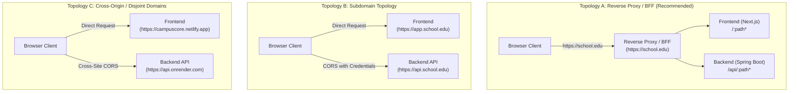

# Session Deployment Topologies, Cookie Security & CORS Architecture

**Feature:** 01 — Enterprise Foundation & Security Hardening  
**Task:** 01.4.2 — Session Reliability & Deployment Verification  
**Author / Developer:** Sathu  
**Date:** November 2026  
**Target Repository:** [EduSmart-AI](https://github.com/Sathurjanv23/EduSmart-AI)  
**Branch:** `feature/01-4-2-session-reliability`

---

## 1. Executive Summary

CampusCore (EduSmart-AI) employs a stateless, server-managed authentication session model rooted in **`HttpOnly` cookies**, backed by **cryptographically signed JWTs with distinct `jti` identifiers**, **hybrid memory/MongoDB revocation**, and **strict defense-in-depth CSRF and Origin protection**.

This document outlines the real-world deployment topologies supported by CampusCore, details exact cookie attribute configurations, analyzes CORS requirements across direct-API vs. reverse-proxy architectures, and provides operational runbooks for production hardening.

---

## 2. Supported Deployment Topologies

CampusCore supports three deployment architectures, each with distinct cookie attribute and CORS implications:



---

### Topology A: Unified Domain / Reverse Proxy / BFF (Production Recommended)

In Topology A, an edge reverse proxy (such as Nginx, AWS ALB, Cloudflare, Traefik, or Next.js API rewrites) terminates public HTTPS traffic and dispatches requests under a single origin:
- `https://school.edu/` routes to Next.js Frontend.
- `https://school.edu/api/` routes to Spring Boot Backend.

#### Advantages:
1. **True Same-Origin Execution:** Eliminates cross-origin CORS overhead and browser pre-flight `OPTIONS` latency.
2. **Strict Cookie Policies:** Allows `SameSite=Strict` or `SameSite=Lax` without risking browser rejection.
3. **Resilience Against Third-Party Cookie Deprecation:** Completely unaffected by Safari ITP, Brave Shields, or Chrome Third-Party Cookie Deprecation (3PCD).
4. **Unified SSL/TLS Management:** A single wildcard or SAN certificate terminates all public connections.

#### Cookie & CORS Configuration:
| Setting | Recommended Value | Notes |
|---|---|---|
| `COOKIE_SAME_SITE` | `Lax` or `Strict` | Provides highest protection against CSRF and cross-site tracking. |
| `COOKIE_SECURE` | `true` | Enforces transmission exclusively over HTTPS. |
| `COOKIE_DOMAIN` | *(Empty / Omitted)* | Restricts cookie scope to `school.edu`. |
| `CORS_ALLOWED_ORIGINS` | `https://school.edu` | Restricts API access strictly to the primary domain. |

#### Sample Nginx Edge Configuration:
```nginx
server {
    listen 443 ssl http2;
    server_name school.edu;

    ssl_certificate /etc/ssl/certs/school.edu.crt;
    ssl_certificate_key /etc/ssl/private/school.edu.key;

    # Frontend Next.js application
    location / {
        proxy_pass http://127.0.0.1:3000;
        proxy_set_header Host $host;
        proxy_set_header X-Real-IP $remote_addr;
        proxy_set_header X-Forwarded-For $proxy_add_x_forwarded_for;
        proxy_set_header X-Forwarded-Proto $scheme;
    }

    # Backend Spring Boot API
    location /api/ {
        proxy_pass http://127.0.0.1:8080/api/;
        proxy_set_header Host $host;
        proxy_set_header X-Real-IP $remote_addr;
        proxy_set_header X-Forwarded-For $proxy_add_x_forwarded_for;
        proxy_set_header X-Forwarded-Proto $scheme;
    }

    # Protected file uploads
    location /uploads/ {
        proxy_pass http://127.0.0.1:8080/uploads/;
        proxy_set_header Host $host;
        proxy_set_header X-Real-IP $remote_addr;
        proxy_set_header X-Forwarded-For $proxy_add_x_forwarded_for;
        proxy_set_header X-Forwarded-Proto $scheme;
    }
}
```

---

### Topology B: Subdomain Architecture (Shared Parent Domain)

In Topology B, frontend and backend reside on separate subdomains of the same registrable domain (eTLD+1):
- Frontend: `https://app.school.edu`
- Backend: `https://api.school.edu`

#### Advantages:
1. Considered **same-site** (though cross-origin) by browser cookie engines.
2. Allows isolated scaling and independent deployment pipelines for frontend and backend infrastructure.
3. Cookies scoped to `.school.edu` are seamlessly shared between subdomains.

#### Cookie & CORS Configuration:
| Setting | Recommended Value | Notes |
|---|---|---|
| `COOKIE_SAME_SITE` | `Lax` | Sent on same-site sub-resource requests and top-level GET navigations. |
| `COOKIE_SECURE` | `true` | Required for HTTPS production. |
| `COOKIE_DOMAIN` | `school.edu` or `.school.edu` | Allows `app.school.edu` to transmit cookies to `api.school.edu`. |
| `CORS_ALLOWED_ORIGINS` | `https://app.school.edu` | Explicit origin whitelist (no wildcards allowed). |

---

### Topology C: Cross-Site / Disjoint Domains (e.g. Netlify + Render/Railway)

In Topology C, the frontend and backend operate on completely disparate domains:
- Frontend: `https://subtle-croissant-c21548.netlify.app`
- Backend: `https://sms-backend.onrender.com`

#### Requirements & Constraints:
1. **Mandatory `SameSite=None; Secure`:** Cross-site cookie transmission requires `SameSite=None` paired with `Secure=true`. `CookieService` strictly validates this combination and throws `IllegalStateException` on startup if `SameSite=None` is attempted over insecure HTTP.
2. **Third-Party Cookie Blocking Vulnerability:**
   - Safari's Intelligent Tracking Prevention (ITP) and Brave Shields block third-party cookies by default.
   - Chrome's Privacy Sandbox initiative deprecates third-party cookies.
   - Under Topology C, users on strict browser settings will experience session loss unless custom domains (Topology A or B) or partitioned cookies (CHIPS) are provisioned.
3. **CORS Headers:**
   - `Access-Control-Allow-Origin` must match the exact frontend origin (wildcards `*` are forbidden when credentials are enabled).
   - `Access-Control-Allow-Credentials: true` is required.
   - `Access-Control-Expose-Headers` exposes `Location`, `Set-Cookie`, and `Content-Disposition`.

---

## 3. Cookie Attributes Matrix & Validation

CampusCore automatically formats both session (`sms_session`) and CSRF (`XSRF-TOKEN`) cookies through `CookieService.java`:

| Attribute | `sms_session` (Session Cookie) | `XSRF-TOKEN` (CSRF Cookie) | Purpose |
|---|---|---|---|
| **HttpOnly** | `true` | `false` | Prevents script theft of JWT; allows client Axios to read CSRF token into headers. |
| **Secure** | `true` (prod) / `false` (dev) | Matches `COOKIE_SECURE` | Restricts cookies to TLS-encrypted connections. |
| **SameSite** | Configured (`Lax`/`Strict`/`None`) | Matches `COOKIE_SAME_SITE` | Defends against cross-site request exploitation. |
| **Path** | `/` | `/` | Scoped to the entire application hierarchy. |
| **Domain** | Configured or null | Matches `COOKIE_DOMAIN` | Enables cross-subdomain sharing when explicitly set. |
| **Max-Age** | Tied to `JWT_EXPIRATION_MS` | Tied to `JWT_EXPIRATION_MS` | Synchronized session lifecycle. |

---

## 4. CSRF Defense & Fetch Metadata Policy

CampusCore applies a layered CSRF defense mechanism:

1. **Double Submit Cookie Pattern:**
   - Spring Security's `CookieCsrfTokenRepository` generates an `XSRF-TOKEN` cookie.
   - Axios client reads `XSRF-TOKEN` and submits it in `X-XSRF-TOKEN` and `X-CSRF-TOKEN` headers on all state-changing requests (`POST`, `PUT`, `PATCH`, `DELETE`).
   - If missing or mismatched, Spring Security halts the request with `403 Forbidden`.

2. **Dedicated Bootstrap Endpoint:**
   - `GET /api/auth/csrf` provides `{ "token": "...", "headerName": "X-CSRF-TOKEN" }` and sets the `XSRF-TOKEN` cookie via `CookieService.attachCsrfCookie()`.
   - Ensures consistent `SameSite`, `Secure`, and `Domain` properties matching the session cookie.

3. **Fetch Metadata & Origin Verification (`RequestOriginValidationFilter`):**
   - Intercepts state-changing requests before Spring Security filter chain.
   - Rejects `Sec-Fetch-Site: cross-site` with `403 Forbidden`.
   - Validates `Origin` and `Referer` headers against `app.cors.allowed-origins`.

---

## 5. Concurrent Requests & Race-Condition Mitigations

High-concurrency SPA frontends frequently trigger multiple parallel requests during initial page mount or route changes (e.g., loading announcements, profile, stats, and timetable concurrently). CampusCore hardens against race conditions through:

1. **Deduplicated CSRF Bootstrapping:**
   - Frontend `apiService.ts` maintains an inflight `csrfTokenPromise`.
   - Multiple parallel requests share a single pending call to `/api/auth/csrf`, avoiding redundant network round trips or cookie race conditions.

2. **Debounced 401 Session Expiration Redirects:**
   - When a session expires, all concurrent API calls receive `401 Unauthorized` almost simultaneously.
   - `apiService.ts` implements a redirect debounce flag (`isRedirectingToLogin`) ensuring that only a single redirect to `/login?returnTo=...` is initiated, preventing browser history corruption.

3. **Stateless JWT Verification with Cached Revocation:**
   - Token validation in `JwtFilter.java` executes purely via cryptographic verification and in-memory `ConcurrentHashMap` lookup ($O(1)$) in `RevokedTokenService.java`.
   - Zero database reads occur during normal concurrent requests, preventing MongoDB connection pool exhaustion.

---

## 6. Protected File Download Verification

All sensitive attachments (student transcripts, assignment submissions, fee receipts, report cards) are accessed via `/uploads/{fileName}` and `/api/uploads/{fileName}`.

1. **Authentication & Authorization:**
   - File requests require an active authenticated session (`sms_session` cookie or Bearer token).
   - `AcademicAccessService.requireFileAccess()` verifies record-level permissions (e.g. students can only download their own submissions; teachers only assigned student work; admin all).
2. **Content-Disposition & Streaming:**
   - `FileDownloadController` returns `Content-Disposition: attachment; filename="<fileName>"`.
   - `CorsConfig.java` explicitly exposes `Content-Disposition` in `ExposedHeaders`.
   - Frontend `downloadProtectedFile()` dynamically extracts original server filenames and downloads via authenticated `Blob` streaming with automatic cleanup of object URLs.

---

## 7. Production Verification Runbook

### Pre-Deployment Checklist
- [ ] Set `COOKIE_SECURE=true` in production `.env`.
- [ ] Set `COOKIE_SAME_SITE=Lax` (or `Strict` for same-origin Topology A).
- [ ] Verify `CORS_ALLOWED_ORIGINS` contains exact production URLs without trailing slashes.
- [ ] Ensure `JWT_SECRET` is at least 32 cryptographically random bytes.
- [ ] If using Topology B, configure `COOKIE_DOMAIN=.yourdomain.com`.

### Post-Deployment Health & Session Checks
Execute the following verification commands against the deployed environment:

```bash
# 1. Verify CSRF endpoint sets XSRF-TOKEN with correct attributes
curl -i -k https://school.edu/api/auth/csrf

# Expected Response Headers:
# Set-Cookie: XSRF-TOKEN=...; Path=/; SameSite=Lax; Secure

# 2. Verify protected endpoints reject unauthenticated access
curl -i -k https://school.edu/api/auth/me
# Expected: HTTP/1.1 401 Unauthorized

# 3. Verify cross-site origin blocking
curl -i -k -X POST https://school.edu/api/auth/login \
  -H "Origin: https://malicious-site.com" \
  -H "Content-Type: application/json" \
  -d '{"email":"admin@campuscore.local","password":"bad"}'
# Expected: HTTP/1.1 403 Forbidden
```
